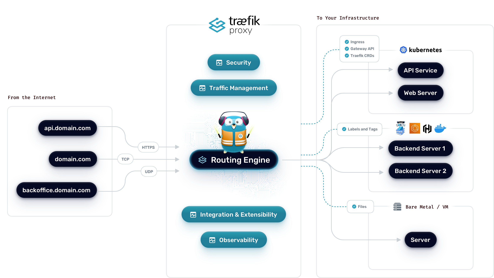
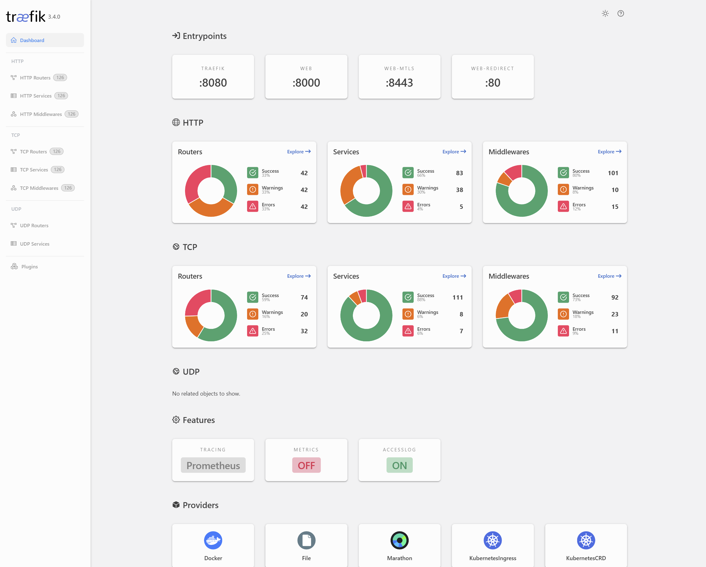

<p align="center">
    <picture>
      <source media="(prefers-color-scheme: dark)" srcset="docs/content/assets/img/traefik.logo-dark.png">
      <source media="(prefers-color-scheme: light)" srcset="docs/content/assets/img/traefik.logo.png">
      
    </picture>
</p>

[](https://doc.traefik.io/traefik)
[](https://github.com/traefik/traefik/blob/master/LICENSE.md)
[](https://community.traefik.io/)
[](https://twitter.com/intent/follow?screen_name=traefik)

Traefik (pronounced _traffic_) is a modern HTTP reverse proxy and load balancer that makes deploying microservices easy.
Traefik integrates with your existing infrastructure components ([Docker](https://www.docker.com/), [Swarm mode](https://docs.docker.com/engine/swarm/), [Kubernetes](https://kubernetes.io), [Consul](https://www.consul.io/), [Etcd](https://coreos.com/etcd/), [Rancher v2](https://rancher.com), [Amazon ECS](https://aws.amazon.com/ecs), ...) and configures itself automatically and dynamically.
Pointing Traefik at your orchestrator should be the _only_ configuration step you need.

---

. **[Overview](#overview)** .
**[Native Fingerprinting & Bot Defense (Custom Additions)](#native-fingerprinting--bot-defense-custom-additions)** .
**[Features](#features)** .
**[Supported backends](#supported-backends)** .
**[Quickstart](#quickstart)** .
**[Web UI](#web-ui)** .
**[Documentation](#documentation)** .

. **[Support](#support)** .
**[Release cycle](#release-cycle)** .
**[Contributing](#contributing)** .
**[Maintainers](#maintainers)** .
**[Credits](#credits)** .

---

## Native Fingerprinting & Bot Defense (Custom Additions)

Este repositório ([`github.com/patrickbrandao/traefik`](https://github.com/patrickbrandao/traefik)) estende o Traefik v3 com **Fingerprinting Multi-Camada Nativo (L3/L4, PROXY Protocol v2, TLS/X.509, QUIC/HTTP/3, HTTP/2 e HTTP/0.9–1.x)**, motor de detecção de contradições *Cross-Layer*, *Session Binding*, desafio *Proof-of-Work* (WebCrypto SHA-256) e inspeção passiva de `ServerHello` upstream (`JA3S`/`JA4S`).

> **Fluxo de Trabalho e Produção Rápida (`master` direto para produção):**
> Neste projeto, **todas as alterações, evoluções e correções são editadas, validadas e commitadas diretamente na branch `master` (equivalente à `main`) e enviadas imediatamente para produção no GitHub (`origin/master`)**. O foco é **colocar em produção rapidamente para testar e validar conceitos em tempo real**, sem burocracia de branches intermediárias ou filas de PR.

### Resumo das Edições e Adições Realizadas

1. **Atualização da Toolchain Go e Dependências (`go.mod` & `pkg/config/dynamic/ext/go.mod`)**
   - Atualizado para **`go 1.27.0`** (`toolchain go1.27.4`), mantendo compatibilidade com o motor de plugins AOT (`yaegi/v2`) e diretivas do projeto.
   - Dependências atualizadas: `github.com/pires/go-proxyproto v0.16.0`, `golang.org/x/{net v0.63.0, mod v0.43.0, tools v0.53.0, crypto, sys, text, sync, time}`, `github.com/rs/zerolog v1.35.1`, `github.com/valyala/fasthttp v1.79.0`, `github.com/andybalholm/brotli v1.3.0`, `github.com/tetratelabs/wazero v1.12.0`, `github.com/traefik/paerser v0.2.3`, `google.golang.org/grpc v1.85.0`, pacotes OpenTelemetry (`sdk/log v1.47.0`, `otlploggrpc v0.23.0`, `otlploghttp v0.23.0`), `k8s.io/{api,apiextensions-apiserver,apimachinery,client-go} v0.37.2` e `sigs.k8s.io/controller-runtime v0.25.3`.

2. **Novo Pacote Core `pkg/fingerprint/` (Zero/Low-Allocation & Bounds-Safe via `cryptobyte`)**
   - **Camada L3/L4 (`tcp_linux.go` / `tcp_other.go` / `tcp_common.go`):** Captura via `TCP_SAVE_SYN` / `TCP_SAVED_SYN` e `TCP_INFO` no Linux (`JA4T`, `TTL`/`HopLimit` IPv4/IPv6 + estimativa de `InitialTTL`/saltos, `DF`, `ECN`, `MSS`, `WScale`, RTT de kernel `JA4L`) e leitura OOB (`IP_RECVTTL` / `IP_RECVTOS` / `IPV6_RECVHOPLIMIT` / `IPV6_RECVTCLASS`) em sockets UDP, com fallback silencioso fora do Linux.
   - **PROXY Protocol v2 (`proxyproto.go`):** Extração de TLVs padrão (`PP2_TYPE_ALPN`, `PP2_TYPE_AUTHORITY`, `PP2_TYPE_SSL`, `PP2_TYPE_NETNS`, `PP2_TYPE_CRC32C`) e TLVs customizados (`0xE0`–`0xE3`) de load balancers L4 upstream.
   - **TLS ClientHello, Deep TLS & ServerHello (`tls.go` & `grease.go`):** Cálculo de `JA4` (`t` para TCP e `q` para QUIC), `JA3` e `JA3N`; remontagem segura de múltiplos records TLS `0x16` (até `16 KB`) para inspecionar `ClientHello` pós-quânticos (`X25519MLKEM768` `0x11ec`), `key_share`, `compress_certificate` (RFC 8879), `ALPS` (`0x4469`/`0x44cd`), `delegated_credentials`, `psk_key_exchange_modes`, `record_size_limit`, `padding`, `legacy_record_version`, `legacy_session_id` e presença de `ECH Outer` (`0xfe0d`); parser passivo de `ServerHello` para `JA3S`/`JA4S` e detecção de `HelloRetryRequest`.
   - **X.509 / mTLS (`x509.go`):** Cálculo de `JA4X` (`IssuerRDNs_SubjectRDNs_ExtensionOIDs` em SHA-256 truncado de 12 chars) e thumbprints SHA-256 `Cert` e `SPKI` compatíveis com RFC 9440 (`Client-Cert-Fp`).
   - **QUIC v1/v2 & HTTP/3 (`quic.go`):** Wrapper `net.PacketConn` que mede o datagrama UDP `Initial`, decifra pacotes `Initial` QUIC v1 (RFC 9001) e v2 (RFC 9369) via `crypto/hkdf` + `AES-128-GCM`, remonta frames `CRYPTO` fragmentados/fora de ordem em cache Sharded LRU com TTL de 5s para extrair a extensão `0x0039` (`quic_transport_parameters`) na ordem da rede, e implementa `qlogwriter.Trace`/`Recorder` em memória (`ParametersSet`, *Unidirectional Streams* com GREASE, `SettingsFrame` H3, pseudo-headers em `HeadersFrame`) desligando a coleta via `atomic.Bool` logo após o handshake/1ª requisição.
   - **HTTP/0.9, HTTP/1.x & HTTP/2 (`http1.go` & `http2.go`):** Scanner de 1º voo HTTP/0.9 e HTTP/1.x preservando ordem original de headers, casing, espaçamento após `:`, `CRLF` vs `LF`, `origin-form` vs `absolute-form` e computando `JA4H` (`a_b_c_d` com opção `redactCookieValues`); e *tap* HTTP/2 (`FirstFlightTapConn`) usando `sync.Pool` de `http2.Framer` + `hpack.Decoder` para extrair o **Akamai HTTP/2 Fingerprint** (`S|WU|P|pseudo`) e sinais HPACK (indexação de headers sensíveis e uso de Huffman), entrando em *passthrough* direto após a `stream 1`.
   - **Motor de Risco Cross-Layer, Session Binding & PoW (`risk.go` & `headers.go`):**
     - **7 regras de contradição *Cross-Layer*:** (1) `ua_tls_mismatch`, (2) `ua_h2_settings_mismatch`, (3) `ua_pseudo_order_mismatch`, (4) `ua_quic_tp_mismatch`, (5) `os_ttl_ja4t_mismatch`, (6) `tls13_h11_downgrade`, (7) `alps_on_non_chromium_tls`.
     - **Session Binding (`SessionBindingCookie`):** Cookie assinado via HMAC-SHA256 vinculado à identidade da pilha TLS/HTTP do cliente, tolerante à troca de IP (roaming Wi-Fi/5G) e à migração `Alt-Svc` entre HTTP/2 (`t13...`) e HTTP/3 (`q13...`).
     - **Step-Up Challenge PoW:** Página HTML/JS leve e autocontida com desafio *Proof-of-Work* SHA-256 via WebCrypto para requisições com risco intermediário (`challengeThreshold <= score < blockThreshold`).

3. **Integração nos EntryPoints, Roteador TCP/TLS, HTTP/3, AccessLog e Upstream**
   - **EntryPoints TCP/TLS & Roteador (`pkg/tcp/tls.go`, `pkg/server/server_entrypoint_tcp.go`, `pkg/server/router/tcp/router.go`):** Wrapper `fpTLSConn` preservando `ConnectionState()`, `HandshakeContext(ctx)` (medindo `TLSHandshakeRTT`) e `UnwrapTLS()`; remontagem de até `16 KB` no `peekConn`; propagação de `*fingerprint.ConnData` em `O(1)` até `http.Server.ConnContext`; e limpeza anti-spoofing + injeção de cabeçalhos **antes** do `httpSwitcher` (permitindo usar `X-Client-Fp` e `X-Fp-*` em regras de roteamento `Header`/`HeaderRegexp`).
   - **HTTP/3 (`pkg/server/server_entrypoint_tcp_http3.go`):** Acoplamento do `QUICTracker` no `PacketConn`, `QUICConfig.Tracer` e `http3.Server.ConnContext` via `c.QlogTrace()`.
   - **AccessLog (`pkg/middlewares/accesslog/`):** Novos campos nativos `ClientJA4`, `ClientJA3N`, `ClientH2FP`, `ClientJA4H`, `ClientJA4T`, `ClientRiskScore`, `UpstreamJA3S` e `UpstreamJA4S`.
   - **Upstream ServerHello (`pkg/server/service/transport.go`):** Opção `captureServerFingerprint: true` em `ServersTransport` para capturar passivamente `JA3S` e `JA4S` dos servidores de backend.
   - **Middleware HTTP & Kubernetes CRD (`pkg/middlewares/fingerprint/`, `pkg/config/dynamic/`, `pkg/provider/kubernetes/crd/`):** Middleware dinâmico `fingerprint` completo + geração atualizada de DeepCopy, clientsets e manifestos CRD.

---

### Cabeçalhos HTTP Injetados

- **Modo `combined` (padrão — RFC 8941 Structured Field Dictionary):**
  - `X-Client-Fp`: `ja4="t13d1516h2_...", ja3n="...", h2="1:65536;2:0;4:6291456;6:262144|15663105|0|m,a,s,p", h3="...", ja4h="ge20cn12enus_...", ja4t="65535_2-4-8-1-3_1460_8", ja4x="...", ttl=64, rtt=12, risk=0`
- **Modo `split` (ou `both`):**
  - `X-Fp-JA4`, `X-Fp-JA3`, `X-Fp-JA3N`, `X-Fp-TLS-Ext`
  - `X-Fp-H2` (Akamai HTTP/2), `X-Fp-H3` (QUIC/HTTP/3), `X-Fp-JA4H` (HTTP/1.x / H2 / H3)
  - `X-Fp-TCP` (`JA4T`), `X-Fp-IP-TTL`, `X-Fp-RTT` (`l4=...;tls=...`)
  - `X-Fp-TLS-Client-Cert` (`JA4X` + RFC 9440 `cert`/`spki`), `X-Fp-Proxy` (PPv2 TLVs)
  - `X-Fp-Risk` (`score=...;reasons=...;action=...`)
- **Assinatura Criptográfica (quando `hmacSecretURN` ou `hmacSecret` está configurado):**
  - `X-Fp-Signature`: `t=<unix_ts>,v1=<hex_hmac_sha256>`

---

### Exemplos de Configuração

#### 1. Configuração Estática (`traefik.yml`)

```yaml
entryPoints:
  web:
    address: ":80"
    fingerprint:
      enabled: true
      injectHeadersMode: combined # combined (padrão) | split | both | none
      enableTCPSYN: true
      enableHTTP2Tap: true
      redactCookieValues: false

  websecure:
    address: ":443"
    http3: {}
    proxyProtocol:
      trustedIPs:
        - "10.0.0.0/8"
    fingerprint:
      enabled: true
      injectHeadersMode: both
      enableTCPSYN: true
      enableDeepTLS: true
      enableHTTP2Tap: true
      enableQUICInitialTap: true
      redactCookieValues: true
      hmacSecretURN: "env:TRAEFIK_FP_HMAC_SECRET"

accessLog:
  format: json
  fields:
    names:
      ClientJA4: keep
      ClientJA3N: keep
      ClientH2FP: keep
      ClientJA4H: keep
      ClientJA4T: keep
      ClientRiskScore: keep
      UpstreamJA3S: keep
      UpstreamJA4S: keep

providers:
  file:
    filename: /etc/traefik/dynamic.yml
```

#### 2. Configuração Dinâmica (`dynamic.yml`)

```yaml
http:
  routers:
    app-secure:
      entryPoints:
        - websecure
      # Como o EntryPoint injeta os cabeçalhos antes do roteamento, regras Header/HeaderRegexp funcionam nativamente:
      rule: "Host(`app.example.com`) && !HeaderRegexp(`X-Fp-JA4`, `^t12`)"
      middlewares:
        - fp-guard
      service: app-backend
      tls: {}

  middlewares:
    fp-guard:
      fingerprint:
        injectHeadersMode: both          # combined (padrão) | split | both | none
        hmacSecret: "env:TRAEFIK_FP_HMAC_SECRET"
        mode: enforce                    # headersOnly (padrão) | shadow | enforce
        challengeThreshold: 50           # Score >= 50 recebe desafio PoW WebCrypto SHA-256
        blockThreshold: 80               # Score >= 80 recebe HTTP 403 Forbidden
        powDifficultyBits: 14            # Bits zero iniciais exigidos no SHA-256 PoW (0..24)
        sessionBindingCookie: "__Host-fp_bind"
        allowCloudASNs: false
        requireCrossLayerConsistency: true
        redactCookieValues: true

  serversTransports:
    inspect-upstream-tls:
      captureServerFingerprint: true     # Captura passiva de UpstreamJA3S e UpstreamJA4S

  services:
    app-backend:
      loadBalancer:
        serversTransport: inspect-upstream-tls
        servers:
          - url: "https://10.10.0.25:8443"
```

#### 3. Kubernetes CRD (`Middleware` e `ServersTransport`)

```yaml
apiVersion: traefik.io/v1alpha1
kind: Middleware
metadata:
  name: fp-guard
  namespace: default
spec:
  fingerprint:
    injectHeadersMode: combined
    hmacSecret: "env:TRAEFIK_FP_HMAC_SECRET"
    mode: enforce
    challengeThreshold: 50
    blockThreshold: 80
    powDifficultyBits: 14
    sessionBindingCookie: "__Host-fp_bind"
    requireCrossLayerConsistency: true
    redactCookieValues: true
---
apiVersion: traefik.io/v1alpha1
kind: ServersTransport
metadata:
  name: inspect-upstream-tls
  namespace: default
spec:
  captureServerFingerprint: true
```

---

:warning: When migrating to a new major version of Traefik, please refer to the [migration guide](https://doc.traefik.io/traefik/migrate/v2-to-v3/) to ensure a smooth transition and to be aware of any breaking changes.


## Overview

Imagine that you have deployed a bunch of microservices with the help of an orchestrator (like Swarm or Kubernetes) or a service registry (like etcd or consul).
Now you want users to access these microservices, and you need a reverse proxy.

Traditional reverse-proxies require that you configure _each_ route that will connect paths and subdomains to _each_ microservice. 
In an environment where you add, remove, kill, upgrade, or scale your services _many_ times a day, the task of keeping the routes up to date becomes tedious. 

**This is when Traefik can help you!**

Traefik listens to your service registry/orchestrator API and instantly generates the routes so your microservices are connected to the outside world -- without further intervention from your part. 

**Run Traefik and let it do the work for you!** 
_(But if you'd rather configure some of your routes manually, Traefik supports that too!)_



## Features

- Continuously updates its configuration (No restarts!)
- Supports multiple load balancing algorithms
- Provides HTTPS to your microservices by leveraging [Let's Encrypt](https://letsencrypt.org) (wildcard certificates support)
- Circuit breakers, retry
- See the magic through its clean web UI
- WebSocket, HTTP/2, gRPC ready
- Provides metrics (Rest, Prometheus, Datadog, Statsd, InfluxDB 2.X)
- Keeps access logs (JSON, CLF)
- Fast
- Exposes a Rest API
- Packaged as a single binary file (made with :heart: with go) and available as an [official](https://hub.docker.com/r/traefik/traefik/) docker image

## Supported Backends

- [Docker](https://doc.traefik.io/traefik/providers/docker/) / [Swarm mode](https://doc.traefik.io/traefik/providers/docker/)
- [Kubernetes](https://doc.traefik.io/traefik/providers/kubernetes-crd/)
- [ECS](https://doc.traefik.io/traefik/providers/ecs/)
- [File](https://doc.traefik.io/traefik/providers/file/)

## Quickstart

To get your hands on Traefik, you can use the [5-Minute Quickstart](https://doc.traefik.io/traefik/getting-started/quick-start/) in our documentation (you will need Docker).

## Web UI

You can access the simple HTML frontend of Traefik.



## Documentation

You can find the complete documentation of Traefik v3 at [https://doc.traefik.io/traefik/](https://doc.traefik.io/traefik/).

## Support

To get community support, you can:

- join the Traefik community forum: [](https://community.traefik.io/)

If you need commercial support, please contact [Traefik.io](https://traefik.io) by mail: <mailto:support@traefik.io>.

## Download

- Grab the latest binary from the [releases](https://github.com/traefik/traefik/releases) page and run it with the [sample configuration file](https://raw.githubusercontent.com/traefik/traefik/master/traefik.sample.toml):

```shell
./traefik --configFile=traefik.toml
```

- Or use the official tiny Docker image and run it with the [sample configuration file](https://raw.githubusercontent.com/traefik/traefik/master/traefik.sample.toml):

```shell
docker run -d -p 8080:8080 -p 80:80 -v $PWD/traefik.toml:/etc/traefik/traefik.toml traefik
```

- Or get the sources:

```shell
git clone https://github.com/traefik/traefik
```

## Introductory Videos

You can find high level and deep dive videos on [videos.traefik.io](https://videos.traefik.io).

## Maintainers

We are strongly promoting a philosophy of openness and sharing, and firmly standing against the elitist closed approach. Being part of the core team should be accessible to anyone who is motivated and want to be part of that journey!
This [document](docs/content/contributing/maintainers-guidelines.md) describes how to be part of the [maintainers' team](docs/content/contributing/maintainers.md) as well as various responsibilities and guidelines for Traefik maintainers.
You can also find more information on our process to review pull requests and manage issues [in this document](https://github.com/traefik/contributors-guide/blob/master/issue_triage.md).

## Contributing

If you'd like to contribute to the project, refer to the [contributing documentation](CONTRIBUTING.md).

Please note that this project is released with a [Contributor Code of Conduct](CODE_OF_CONDUCT.md).
By participating in this project, you agree to abide by its terms.

## Release Cycle

- We usually release 3/4 new versions (e.g. 1.1.0, 1.2.0, 1.3.0) per year.
- Release Candidates are available before the release (e.g. 1.1.0-rc1, 1.1.0-rc2, 1.1.0-rc3, 1.1.0-rc4, before 1.1.0).
- Bug-fixes (e.g. 1.1.1, 1.1.2, 1.2.1, 1.2.3) are released as needed (no additional features are delivered in those versions, bug-fixes only).

Each version is supported until the next one is released (e.g. 1.1.x will be supported until 1.2.0 is out).

We use [Semantic Versioning](https://semver.org/).

## Mailing Lists

- General announcements, new releases: mail at news+subscribe@traefik.io or on [the online viewer](https://groups.google.com/a/traefik.io/forum/#!forum/news).
- Security announcements: mail at security+subscribe@traefik.io or on [the online viewer](https://groups.google.com/a/traefik.io/forum/#!forum/security).

## Credits

Kudos to [Peka](https://www.instagram.com/pierroks/) for his awesome work on the gopher's logo!

The gopher's logo of Traefik is licensed under the Creative Commons 3.0 Attributions license.

The gopher's logo of Traefik was inspired by the gopher stickers made by [Takuya Ueda](https://twitter.com/tenntenn).
The original Go gopher was designed by [Renee French](https://reneefrench.blogspot.com/).
