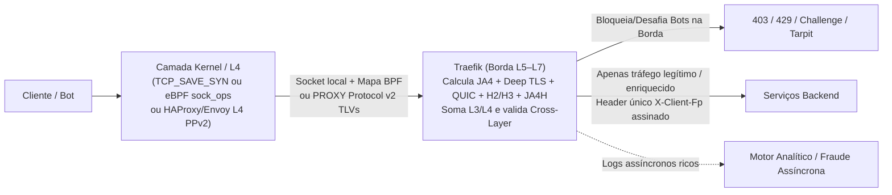

# Viabilidade, Arquitetura e Estratégia de Implementação de Fingerprinting no Traefik

> **Escopo e base técnica:** Análise elaborada com base no catálogo de [`./tmp/fingerprint.md`](./fingerprint.md) e inspecionando diretamente o código-fonte atual deste repositório local do Traefik (`go 1.27.0` em [`go.mod`](../go.mod), EntryPoints TCP/HTTP/HTTPS em [`pkg/server/server_entrypoint_tcp.go`](../pkg/server/server_entrypoint_tcp.go), HTTP/3 em [`pkg/server/server_entrypoint_tcp_http3.go`](../pkg/server/server_entrypoint_tcp_http3.go), roteador TCP/TLS em [`pkg/server/router/tcp/router.go`](../pkg/server/router/tcp/router.go), sockets Unix em [`pkg/server/server_entrypoint_listenconfig_unix.go`](../pkg/server/server_entrypoint_listenconfig_unix.go) e proxies upstream em [`pkg/proxy/smart_builder.go`](../pkg/proxy/smart_builder.go)).
>
> **Diretriz de Escopo de Implementação (Obrigatória para a Próxima Sessão):** A implementação prática neste projeto abrange **exclusivamente o que é executado dentro do próprio Traefik (Go + syscalls nativas do SO + bibliotecas já presentes no `go.mod`)**. O desenvolvimento de softwares externos de *sniffer* (`pcap`/Zeek) e programas de kernel **eBPF/XDP** está **estritamente fora do escopo de implementação** (mencionado nas Seções 1 a 8 apenas para responder às perguntas comparativas de arquitetura). A **Seção 9** consolida o *blueprint* completo, arquivo por arquivo, de tudo que será codificado no Traefik.

---

## 1. Quais assinaturas podemos implementar no Traefik local?

A arquitetura do Traefik permite implementar **praticamente todas as assinaturas de camadas L4.5 (QUIC), L5 (TLS/mTLS) e L7 (HTTP/0.9 a HTTP/3, Túneis e Cross-Layer)** diretamente em Go dentro do binário, divididas em **três níveis (Tiers) de complexidade e portabilidade**:

| Tier | Assinaturas do `fingerprint.md` | Viabilidade no Traefik | Onde conectar no código atual |
|---|---|---|---|
| **Tier 1 — Nativo / Imediato** *(APIs já expostas pelas libs atuais)* | • **`JA4` (`t` em TCP e `q` em QUIC)**<br>• **`JA4X`** & **Cert/SPKI Pinning** ([RFC 9440](https://www.rfc-editor.org/rfc/rfc9440))<br>• **PROXY Protocol v2 TLVs**<br>• **Sinais Semânticos L7 & Cross-Layer** (`Sec-CH-UA*`, `Sec-Fetch-*`, `WebSocket` headers, `gRPC`, transição `Alt-Svc`, multiplexação por conexão) | **100% viável hoje**, multiplataforma (Linux, macOS, Windows, BSD), sem parsear pacotes brutos de rede. | • `GetCertificate` / `GetConfigForClient` em [`pkg/tls/tlsmanager.go`](../pkg/tls/tlsmanager.go) e [`pkg/server/server_entrypoint_tcp_http3.go`](../pkg/server/server_entrypoint_tcp_http3.go)<br>• `req.TLS.PeerCertificates` em middleware HTTP (ao lado de [`pkg/middlewares/passtlsclientcert/`](../pkg/middlewares/passtlsclientcert/))<br>• `proxyproto.Listener` em [`pkg/server/server_entrypoint_tcp.go`](../pkg/server/server_entrypoint_tcp.go) |
| **Tier 2 — Interceptação Local em User-Space** *(Wrappers de `net.Conn`, `PacketConn` e `qlog` sem fork)* | • **`JA3` / `JA3N`** estritos<br>• **Deep TLS / PeetPrint** (`key_share` pós-quântico `X25519MLKEM768`, `compress_certificate`, `ALPS`, `delegated_credentials`, `padding`, `legacy_record_version`, `legacy_session_id`)<br>• **ECH / `JA4E`** (Outer + Inner quando o Traefik tem a chave ECH)<br>• **UDP Envelope**, **QUIC `Initial` Header** e **QUIC Transport Parameters (`0x0039`)**<br>• **HTTP/0.9 Raw** & **HTTP/1.x Sintático + `JA4H`** (ordem, casing, espaçamento, `origin-form` vs `absolute-form`)<br>• **Akamai HTTP/2 Fingerprint** (`SETTINGS`, `WINDOW_UPDATE`, `PRIORITY`/`PRIORITY_UPDATE`, ordem de pseudo-headers `m,a,s,p`)<br>• **HTTP/3 Framing** (ordem de Unidirectional Streams, GREASE streams, pseudo-headers e valores de `SETTINGS`)<br>• **RTT Differential parcial** (TLS/H2/WS RTT) e **Upstream `JA3S`/`JA4S`** | **Totalmente viável com código local** em Go puro, mantendo 100% de portabilidade de SO, interceptando bytes antes da normalização das bibliotecas. | • Extensão do `peekConn` em [`pkg/server/router/tcp/router.go`](../pkg/server/router/tcp/router.go)<br>• Wrapper de `net.Conn` pós-TLS antes de `httpForwarder`/`httpsForwarder` em [`pkg/server/server_entrypoint_tcp.go`](../pkg/server/server_entrypoint_tcp.go)<br>• Wrapper de `net.PacketConn` + `quic.Config.Tracer` (`qlog`) em [`pkg/server/server_entrypoint_tcp_http3.go`](../pkg/server/server_entrypoint_tcp_http3.go)<br>• Dialer customizado em [`pkg/server/service/transport.go`](../pkg/server/service/transport.go) |
| **Tier 3 — Dependente de Kernel/SO ou Fora do Escopo de User-Space Go** | • **`JA4T` / `JA4TS` / `p0f`** (pacote TCP `SYN`: `Window Size`, ordem de `TCP Options`, `MSS`, `WScale`)<br>• **IP L3** (`TTL`/`Hop Limit` recebido em TCP, bit `DF`, `IP ID`, IPv6 `Flow Label`)<br>• **`JA4L` estrito** (RTT exato do kernel no `SYN`→`ACK`)<br>• **H3 `SETTINGS` wire-order exata & QPACK dinâmico profundo**<br>• **`gQUIC` legado (`CYU`)** e **Túneis `MASQUE` (`CONNECT-UDP`/`CONNECT-IP`)** | **Parcial / Condicional**:<br>• `JA4T` + `TTL` TCP funcionam nativamente **apenas em Linux** via `TCP_SAVE_SYN` + `TCP_INFO` (`getsockopt`), ou via eBPF / PROXY Protocol v2.<br>• `gQUIC` e `CONNECT`/`MASQUE` não são protocolos servidos pelo Traefik (apenas detecção de tentativa/rejeição). | • `ListenConfig.Control` em [`pkg/server/server_entrypoint_listenconfig_unix.go`](../pkg/server/server_entrypoint_listenconfig_unix.go) (build tag `//go:build linux`)<br>• Ou ingestão via TLVs do `go-proxyproto` / mapa eBPF compartilhado. |

> **Aviso jurídico importante (Licenciamento JA4+):** Conforme destacado em `fingerprint.md`, apenas o **`JA4` (TLS/QUIC ClientHello)** possui licença aberta **BSD-3-Clause**. As demais especificações da família **JA4+** (`JA4H`, `JA4T`, `JA4TS`, `JA4L`, `JA4X`, `JA4S`) estão sob a **FoxIO License**, que restringe certos usos comerciais/redistribuição sem acordo. Caso o projeto tenha restrição de licença open-source estrita (como o próprio upstream do Traefik, que é MIT), pode-se usar `JA4` oficial + `JA3N` + `Akamai H2` + hashes canônicos próprios inspirados nos mesmos sinais técnicos (ex.: SHA-256 próprio de headers/certificados/opções TCP).

---

## 2. Desafios técnicos para implementar cada tipo no Traefik

### 2.1 Camadas L3 (IP) e L4 (TCP / UDP / Tempo — `p0f`, `JA4T`, `JA4L`, UDP Envelope)
- **Consumo do `SYN` pelo Kernel antes do `Accept()`:** Em Go, `listener.Accept()` ([`pkg/server/server_entrypoint_tcp.go:264`](../pkg/server/server_entrypoint_tcp.go#L264)) só retorna o `*net.TCPConn` **depois** que o kernel já completou o *3-way handshake* (`SYN` → `SYN-ACK` → `ACK`). O pacote `SYN` original (onde moram `Window Size` inicial, `MSS`, `WScale` e a ordem das `TCP Options`) já foi descartado.
  - *Contorno em Linux:* habilitar `unix.TCP_SAVE_SYN` no `ListenConfig.Control` e ler `unix.TCP_SAVED_SYN` via `getsockopt` logo após o `Accept()` (retorna os cabeçalhos IP + TCP brutos do `SYN`, entregando **simultaneamente `JA4T` e o `TTL`/`DF` real de L3**!). Porém, isso exige permissão (`CAP_NET_ADMIN` em alguns kernels para certas opções, embora `TCP_SAVE_SYN` funcione em sockets normais no Linux moderno) e **não existe em macOS, FreeBSD ou Windows**.
- **Perda de L3/L4 atrás de Load Balancers / CDNs:** Se o Traefik rodar atrás de AWS NLB/ALB, GCP LB, Cloudflare ou `kube-proxy` em modo `iptables`/IPVS NAT sem preservação, o `TTL`, `MSS` e opções TCP vistos pelo socket são os do balanceador, não os do cliente.
- **UDP Envelope em QUIC:** `http3.Server.Serve(conn net.PacketConn)` lê os datagramas internamente. Envolver `net.PacketConn` para medir o tamanho do primeiro pacote UDP (`1200`, `1252`, `1350`, `1472`) é fácil, mas ler bits `ECN` e `TTL` do cabeçalho IP em UDP requer `ReadMsgUDP` com flags de controle OOB (`IP_RECVTOS` / `IP_RECVTTL` / `IPV6_RECVHOPLIMIT`).

### 2.2 Camada QUIC (`Initial`, Transport Parameters `0x0039`) e HTTP/3 (`SETTINGS`, Streams, QPACK)
- **Pacote `Initial` cifrado e possivelmente fragmentado:** Diferente do TCP (onde o `ClientHello` viaja em texto claro), no QUIC o `ClientHello` viaja dentro de frames `CRYPTO` protegidos por AEAD (`AES-128-GCM`) e *Header Protection* ([RFC 9001 §5.2](https://www.rfc-editor.org/rfc/rfc9001#section-5.2)). Embora qualquer proxy possa decifrá-lo (pois a chave deriva de um *salt* público da RFC + `DCID` do cliente), clientes com `ClientHello` pós-quântico (`X25519MLKEM768`) frequentemente **fragmentam o `ClientHello` em 2 ou 3 datagramas UDP `Initial`** ou enviam frames `CRYPTO` fora de ordem para burlar DPI. Um parser ingênuo de 1 único pacote UDP falhará justamente nos browsers modernos!
- **Ausência de `net.Conn` no HTTP/3:** No Traefik, requisições HTTP/1.1 e HTTP/2 chegam por `http.Server` (`ConnContext(ctx, net.Conn)`), mas requisições HTTP/3 chegam por `http3.Server` (`ConnContext(ctx, *quic.Conn)` em [`pkg/server/server_entrypoint_tcp_http3.go:83`](../pkg/server/server_entrypoint_tcp_http3.go#L83)), onde `tls.ClientHelloInfo.Conn` é `nil`! Para correlacionar o `JA4` calculado em `GetConfigForClient` com o `*http.Request` do HTTP/3, é necessário usar `clientHello.Context()` ou indexar pelo `ConnectionState` / wrapper de certificado.
- **Limitações de ordenação no `qlog` do `quic-go`:** O `quic-go v0.65.0` oferece `quic.Config.Tracer` em memória, mas o evento `http3/qlog.SettingsFrame` armazena settings desconhecidos/GREASE num `map[uint64]uint64` (`Other`), perdendo a **ordem exata na rede** dos `SETTINGS` HTTP/3, além de `quic-go/http3` atualmente não negociar tabela dinâmica QPACK (`SETTINGS_QPACK_MAX_TABLE_CAPACITY = 0`), o que impede observar inserções dinâmicas QPACK do cliente sem alterar a biblioteca.

### 2.3 Camada TLS (`JA3`, `JA3N`, `JA4`, Deep TLS, ECH, `JA4X`, `JA3S`/`JA4S`)
- **Limites do `tls.ClientHelloInfo` padrão:** No Go `1.27`, `tls.ClientHelloInfo` já entrega tudo para o **`JA4`** (`CipherSuites`, `Extensions`, `SupportedVersions`, `SupportedProtos`, `SignatureSchemes` preservando GREASE e ordem). Contudo, ele **não expõe**:
  1. `legacy_version` do cabeçalho do `ClientHello` nem `legacy_record_version` (necessários para o `JA3` clássico estrito);
  2. Os **bytes internos (payloads)** das extensões para *Deep TLS / PeetPrint* (`key_share` `0x0033`, `compress_certificate` `0x001b`, `ALPS` `0x4469`/`0x44cd`, `delegated_credentials` `0x0022`, tamanho de `padding` `0x0015`).
- **Tamanho do buffer de `peekConn` e Fragmentação de Records TLS:** Em [`pkg/server/router/tcp/router.go:371`](../pkg/server/router/tcp/router.go#L371), `newPeekConn` usa `bufio.NewReader(conn)` (buffer default de `4096` bytes). Com chaves híbridas pós-quânticas (`X25519MLKEM768` soma ~1.2 KB só no `key_share`) + tickets de sessão PSK grandes ou `ECH`, o `ClientHello` pode ultrapassar `4096` bytes ou vir **dividido em múltiplos TLS Records `0x16`** pequenos (técnica clássica de evasão de DPI). O parser no `peekConn` precisa remontar records `0x16` consecutivos até completar o cabeçalho do Handshake (`HandshakeTypeClientHello = 0x01`), com um teto rígido (ex.: `16 KB`) e *deadline* curto para evitar ataques Slowloris.
- **`HelloRetryRequest` (HRR) e TLS Session Resumption:** Se o servidor pedir HRR, o cliente envia um segundo `ClientHello` na mesma conexão; na retomada de sessão (PSK), certas extensões mudam. O coletor deve registrar o 1º `ClientHello` e sinalizar a flag `HelloRetryRequest`.
- **Routers TCP com `tls.passthrough = true`:** Quando o Traefik não termina o TLS, ele ainda vê o `ClientHello` no `peekConn` (podendo logar `JA4`/`JA3`), mas **não pode injetar cabeçalhos HTTP**, pois o tráfego continua cifrado até o backend.

### 2.4 Camada HTTP/0.9, HTTP/1.0 e HTTP/1.1 (`JA4H` e Sintaxe Textual)
- **Destruição da ordem e do casing pelo `net/http`:** Antes de qualquer middleware do Traefik rodar, `net/http.ReadRequest` converte cada linha de cabeçalho usando `textproto.CanonicalMIMEHeaderKey` e insere num `map[string][]string` (`http.Header`). Com isso, **toda a ordem dos cabeçalhos, o casing (`sec-ch-ua` vs `Sec-CH-UA`), espaços após `:` e duplicatas brutas já foram perdidos**.
- **Conexões Keep-Alive e Pipelining:** Em HTTP/1.1, uma mesma `net.Conn` processa dezenas de requisições em sequência. Se você quiser apenas o fingerprint da 1ª requisição da conexão, basta inspecionar até o primeiro `\r\n\r\n` e entrar em modo *bypass*; mas se quiser o **`JA4H` exato de cada requisição** (já que cookies, `Referer` e contagem de headers mudam entre `GET /login` e `POST /api`), um simples wrapper de `net.Conn` precisaria parsear `Content-Length` e `Transfer-Encoding: chunked` de todo o fluxo HTTP/1.1 — o que é complexo e arriscado (risco de dessincronização/*HTTP Request Smuggling* se divergir do parser do `net/http`!).
  - *Solução limpa:* capturar os **sinais sintáticos e a ordem de headers da 1ª requisição** no wrapper de `net.Conn` (por conexão) e, para as requisições seguintes, ou reutilizar o vetor de ordem da conexão, ou avaliar `Cookie`/`Referer`/`Accept-Language` no middleware HTTP sabendo que a parte `b` (ordem em H1.1 keep-alive) reflete o perfil inicial do socket.

### 2.5 Camada HTTP/2 (`Akamai HTTP/2 Fingerprint` e HPACK)
- **Código HTTP/2 interno ao `net/http`:** No Traefik atual ([`pkg/server/server_entrypoint_tcp.go:678-684`](../pkg/server/server_entrypoint_tcp.go#L678-L684)), `h2` e `h2c` rodam sobre a implementação **interna embutida no `net/http` do Go 1.27** (`http.Protocols` + `http.HTTP2Config`), que não expõe nenhum callback para `SETTINGS`, `WINDOW_UPDATE`, `PRIORITY` nem ordem de pseudo-headers.
- **Correlação Conexão vs. Stream e Estado HPACK:**
  - Felizmente, **99% da entropia do Akamai HTTP/2 Fingerprint é por conexão**: o frame `SETTINGS` inicial (stream `0`), o `WINDOW_UPDATE` inicial (stream `0`), os frames `PRIORITY` iniciais de startup e a **ordem dos pseudo-headers (`:method, :authority, :scheme, :path`) na primeira requisição (`stream 1`)** são fixos pela engine do cliente durante toda a conexão!
  - Isso elimina o maior perigo: **não precisamos manter um `hpack.Decoder` paralelo decodificando todas as streams da conexão inteira**, basta observar os primeiros KB da conexão desencapsulada pós-TLS até ler o 1º frame `HEADERS` completo, gravar a assinatura Akamai H2 no `ConnContext`, e desligar o parser! (Se tentássemos rastrear variações por requisição individual em H2, esbarraríamos no fato de que `net/http` não expõe o `StreamID` no `*http.Request`).

### 2.6 Segurança na Injeção dos Cabeçalhos para o Backend
- **Header Spoofing / Aliasing:** Se o Traefik enviar `X-FP-JA4` ao backend, um atacante pode mandar `X-FP-JA4: falso` ou `X_FP_JA4: falso` (interpretado como `HTTP_X_FP_JA4` por backends PHP/WSGI/FastCGI/Nginx). O middleware de fingerprint do Traefik deve **deletar incondicionalmente qualquer header do prefixo reservado** vindo do cliente antes de gravar os valores calculados, além de exigir `aliasHeadersStrategy: reject` (ou `delete`) no EntryPoint.

---

## 3. Quais bibliotecas o Traefik usa hoje e como elas lidam com essas implementações?

Analisando o [`go.mod`](../go.mod) e os pacotes em `pkg/`:

| Biblioteca no Traefik | Versão no `go.mod` | Onde atua no Traefik | Como lida com Fingerprinting |
|---|---|---|---|
| **`crypto/tls`** | Go `1.27.0` (stdlib) | Terminação TLS 1.2/1.3 em TCP e motor criptográfico do `quic-go` | **Excelente para `JA4` e ECH:** `ClientHelloInfo.Extensions` (adicionado no Go 1.24+) e `EncryptedClientHelloKeys` já são nativos. **Limitado para `JA3`/Deep TLS:** oculta bytes internos das extensões e `legacy_version`, exigindo leitura via `peekConn` antes de `tls.Server`. |
| **`crypto/x509` + `golang.org/x/crypto/cryptobyte`** | Go `1.27.0` / `v0.59.0` | Certificados TLS, mTLS (`passTLSClientCert`) e parsing ASN.1/TLS | **Suporte total e ideal:** `x509.Certificate.Raw` entrega o DER bruto para `JA4X` e RFC 9440; `cryptobyte.String` é a mesma biblioteca usada internamente pelo Go para parsear mensagens TLS e extensões com segurança de memória (*bounds-safe*) e zero alocação. |
| **`net/http`** *(inclui `h2` e `h2c` internos)* | Go `1.27.0` (stdlib) | Servidor HTTP/1.1, HTTP/2 (`h2`) e `h2c` em `newHTTPServer` | **Hostil a metadados brutos de wire:** normaliza nomes de headers (`CanonicalMIMEHeaderKey`), usa `map` sem ordem (`http.Header`), consome frames H2 internamente e rejeita HTTP/0.9. Exige interceptação na `net.Conn` entregue pelo `httpForwarder`/`httpsForwarder` + propagação via `ConnContext`. |
| **`golang.org/x/net/http2` + `http2/hpack`** | `v0.62.0` | Testes e utilitários H2 (já presente no `go.mod`!) | Embora `newHTTPServer` use o H2 da stdlib, `x/net/http2.NewFramer` e `hpack.NewDecoder` **já estão no `go.mod`** e podem ser usados como **leitor passivo (*tap*)** sobre os primeiros frames da conexão H2 desencapsulada sem precisar reinventar um parser binário de frames RFC 9113! |
| **`github.com/quic-go/quic-go`** + **`quic-go/http3`** + **`quic-go/qpack`** | `v0.65.0` / `v0.6.0` | Servidor QUIC v1/v2 e HTTP/3 em `server_entrypoint_tcp_http3.go` | **Muito bom via `qlog` + `PacketConn`:** `quic.Config.Tracer` entrega eventos tipados em memória (`qlog.ParametersSet`, `PacketReceived`, `http3/qlog.StreamTypeSet`, `HeadersFrame` com pseudo-headers na ordem exata!). Apenas a ordem bruta de `SETTINGS` H3, QPACK dinâmico e extensões opacas do `ClientHello` QUIC exigem decodificar o pacote `Initial` no `net.PacketConn` (ou patch mínimo). |
| **`github.com/pires/go-proxyproto`** | `v0.12.0` | Listener PROXY Protocol v1/v2 em `buildProxyProtocolListener` | **Pronto para TLVs:** `Header.TLVs()` já lê TLVs arbitrários da especificação HAProxy PPv2 (`PP2_TYPE_SSL`, `PP2_TYPE_ALPN` ou TLVs customizados `0xE0`–`0xEF` carregando `JA4T`/`TTL` vindos de um balanceador L4/eBPF externo). **Detalhe:** hoje o Traefik apenas envolve o listener para sobrescrever `RemoteAddr()`; basta fazer *type assertion* para `*proxyproto.Conn` no `ConnContext` para extrair os TLVs! |
| **`golang.org/x/sys/unix`** | `v0.50.0` | Opções de socket (`SO_REUSEPORT`) em `server_entrypoint_listenconfig_unix.go` | **Suporte direto às syscalls Linux:** já possui constantes e wrappers para `SetsockoptInt` (`TCP_SAVE_SYN`), `GetsockoptByteSlice` (`TCP_SAVED_SYN`) e `GetsockoptTCPInfo` (`TCP_INFO` para RTT L4). |
| **`net/http/httputil`** & **`github.com/valyala/fasthttp`** | stdlib / `v1.73.0` | Clientes HTTP de *upstream* (Traefik → Backend) em `pkg/proxy/` | Repassam transparentemente qualquer header `X-FP-*` adicionado ao `*http.Request` pelos middlewares. Para calcular `JA3S`/`JA4S` de servidores *upstream*, ambos permitem injetar `DialContext`/`DialTLSContext` customizados no transporte. |
| **Plugins (`yaegi/v2` e `http-wasm-host-go` / `wazero`)** | `v2.0.0-...` / `v0.7.0` | Middlewares dinâmicos de terceiros em `pkg/plugins/` | **Não conseguem extrair fingerprints de rede sozinhos** (recebem apenas `http.ResponseWriter` e `*http.Request` já normalizados; WASM sequer acessa `req.TLS` completo). Porém, **são excelentes consumidores** dos cabeçalhos `X-FP-*` quando o core do Traefik faz a extração no EntryPoint. |

---

## 4. Vale a pena obter as bibliotecas sem suporte fácil e alterá-las (Fork)?

**Na quase totalidade dos casos: NÃO.** Manter forks das bibliotecas de rede base do Traefik traz um custo operacional altíssimo e desnecessário. Veja a análise por dependência:

1. **`crypto/tls` e `net/http` (Standard Library do Go — veredito: NUNCA fazer fork):**
   - No Traefik atual (`go 1.27.0`), tanto o TLS quanto o HTTP/1.1, HTTP/2 (`h2`) e `h2c` rodam dentro da **stdlib do Go**.
   - Alterar `crypto/tls` ou `net/http` obrigaria você a **compilar e manter um fork próprio da distribuição do compilador Go** a cada release de segurança mensal do Go, *ou* copiar dezenas de milhares de linhas para pacotes externos quebrando *type assertions* `c.(*tls.Conn)` em todo o ecossistema (`net/http`, `quic-go`, `http.ResponseController`).
   - Como um wrapper não-invasivo de `net.Conn` / `peekConn` resolve TLS bruto, HTTP/1.x e HTTP/2 inicial com ~600 linhas isoladas, fazer fork da stdlib seria um erro grave de engenharia.

2. **`github.com/quic-go/quic-go` (Módulo externo em `go.mod` — veredito: EVITAR fork; só justificável em 1 caso extremo):**
   - Com o `Tracer` (`qlog`) nativo do `quic-go v0.65.0` + um interceptador leve de `net.PacketConn` para o pacote `Initial`, você já obtém **`JA4` (`q...`), UDP Envelope, QUIC Header, QUIC Transport Parameters (com ordem na rede via `Initial` decrypt), Unidirectional Streams (incluindo GREASE), Pseudo-Headers H3 e valores de `SETTINGS` H3** sem tocar numa linha do `quic-go`.
   - O **único caso** em que um `replace github.com/quic-go/quic-go => ...` no `go.mod` (~40 linhas de patch) traria ganho real é se você precisar **obrigatoriamente** da *ordem bruta na rede* dos IDs dentro do frame `SETTINGS` do HTTP/3 (que cai após o pacote `Initial`, já nas chaves `1-RTT`) ou ativar inspeção de tabela dinâmica QPACK. Para 99% dos cenários de detecção de bots, os sinais já disponíveis sem fork no QUIC/H3 são mais do que suficientes para desmascarar qualquer scraper.

3. **Bibliotecas externas prontas de JA3/JA4 no GitHub (veredito: NÃO adotar nem fazer fork):**
   - Grande parte dos pacotes Go públicos de `ja3`/`ja4` puxa dependências pesadas com CGO (`gopacket`/`libpcap`), depende de forks desatualizados de `refraction-networking/utls`, ou faz alocações excessivas com `fmt.Sprintf` e regex por pacote.

---

## 5. É mais prático desenvolver código local em vez de utilizar bibliotecas externas de fingerprint?

**Sim — desenvolver pacotes locais próprios dentro do Traefik (ex.: `pkg/fingerprint/...`) apoiados exclusivamente na stdlib do Go, `golang.org/x/crypto/cryptobyte` e `golang.org/x/net/http2` é de longe a abordagem mais prática, rápida, segura e sustentável.**

**Por quê?**
- **Algoritmos pequenos e especificações fechadas:**
  - Cálculo de `JA4` a partir de `*tls.ClientHelloInfo`: **~120 linhas de Go puro** (`slices.Sort`, `sha256.Sum256`, `hex.EncodeToString`).
  - Parser de TLS Record + `ClientHello` bruto (`JA3`, `JA3N`, `key_share`, `ALPS`, `compress_certificate`, `QUIC TP 0x0039`) usando `cryptobyte.String`: **~250 linhas**, imune a *buffer over-read* (panics) com inputs truncados ou maliciosos.
  - Decriptação de pacote QUIC `Initial` (RFC 9001 §5.2 — HKDF-Expand-Label com o *salt* fixo da RFC + `aes.NewCipher` + `cipher.NewGCM`): **~180 linhas** usando `crypto/aes`, `crypto/cipher` e `crypto/hkdf` (Go 1.24+ stdlib!).
  - Tap passivo do 1º voo HTTP/2 usando `golang.org/x/net/http2.NewFramer` + `hpack.NewDecoder`: **~160 linhas**.
  - Parser `JA4X` + thumbprint RFC 9440 sobre `x509.Certificate.Raw` (`encoding/asn1`): **~100 linhas**.
- **Zero CGO e compilação cruzada intacta:** O binário estático do Traefik continua compilando nativamente para `linux/amd64`, `linux/arm64`, `darwin/arm64`, containers `scratch`/Alpine, sem depender de `libpcap`.
- **Controle total de performance (*zero-allocation*):** Código local permite usar `sync.Pool`, arrays fixos na stack (`var buf [64]uint16`) e desligar os wrappers imediatamente após o handshake (*short-circuit*), algo que bibliotecas genéricas de mercado raramente fazem.
- **Conformidade com as regras do repositório ([`AGENTS.md`](../AGENTS.md)):** Integração nativa com `zerolog`, propagação de `context.Context`, chaves de contexto tipadas não exportadas e preservação estrita de `Unwrap()` em qualquer wrapper.

---

## 6. Impacto de performance ao calcular fingerprints e enviá-los nos cabeçalhos aos backends

A resposta curta é: **se projetado com *short-circuit* por conexão, o impacto de performance em throughput e latência P99 é mínimo (< 1% a 2% de CPU e < 15 µs apenas na abertura da conexão, ~0,1 µs nas requisições subsequentes). Porém, se implementado de forma ingênua inspecionando todo o fluxo de bytes por requisição, pode degradar o throughput em 10%–25%.**

### 6.1 Custo detalhado por classe de assinatura

| Classe de Operação | Frequência | Custo estimado por evento (CPU moderna) | Impacto em conexões reutilizadas (H1 Keep-Alive / H2 / H3) |
|---|---|---|---|
| **`JA4` via `ClientHelloInfo`** | 1× por handshake TLS/QUIC | **~1,5 a 3 µs** (ordenação de ~16 `uint16` + 2 hashes SHA-256 de < 100 B) | **Praticamente zero** (< 0,2% comparado à criptografia ECDHE/ML-KEM do próprio handshake TLS, que custa centenas de µs). |
| **Parser TLS Raw (`JA3N` + Deep TLS via `peekConn`)** | 1× por conexão TCP/TLS | **~2 a 5 µs** (leitura zero-copy do buffer já existente no `peekConn`!) | **Zero após o handshake** se `peekConn` esvaziar `peeked` e passar a delegar `Read` direto. *(Nota: o Traefik **já** faz um handshake `tls.Server` falso no `peekConn` hoje em [`router.go:438`](../pkg/server/router/tcp/router.go#L438) para ler SNI/ALPN! Um parser `cryptobyte` único pode até **acelerar** o Traefik atual substituindo esse handshake simulado!)* |
| **Decriptação QUIC `Initial` + `qlog` Tracer em memória** | 1× no 1º pacote da conexão QUIC | **~5 a 12 µs** (1 HKDF + 1 AES-GCM sobre ~1250 B; `qlog` apenas para eventos iniciais) | **Desprezível** desde que o `qlogwriter.Recorder` ignore eventos `PacketSent`/`PacketReceived`/`MetricsUpdated` após o handshake completo! *(Atenção: deixar `qlog` ativo para todos os pacotes `1-RTT` de dados causaria overhead significativo de alocação).* |
| **Tap HTTP/2 (`SETTINGS` + `WINDOW_UPDATE` + 1º `HEADERS`)** | 1× nos primeiros ~2 KB da conexão H2 | **~4 a 8 µs** usando `sync.Pool` para `http2.Framer` e `hpack.Decoder` | **Zero para o resto da conexão** quando o wrapper entra em modo *passthrough* após a `stream 1`. *(Se mantivesse o `Framer` lendo todos os frames `DATA` de uploads/downloads, haveria cópia extra de memória e queda sensível de throughput).* |
| **Inspeção H1.x + `JA4H` por requisição** | **1× por requisição HTTP** | **~1 a 3 µs** (SHA-256 de nomes de headers e cookies ordenados) | **Moderado (2% a 5% CPU)** em APIs de altíssimo RPS (> 50k req/s por nó) com muitos cookies grandes. Deve ser configurável por rota/middleware. |
| **Injeção dos cabeçalhos `X-FP-*` para o Backend** | **1× por requisição HTTP** | **~50 a 200 ns** em memória + ~120 a 300 bytes no fio (HTTP/1.1) ou **~10 a 30 bytes** via tabela dinâmica HPACK (HTTP/2 upstream) | **Irrelevante**, desde que não se enviem dezenas de cabeçalhos gigantes (como PEM inteiro de mTLS sem necessidade). |

### 6.2 As 4 regras de ouro para não perder performance no Traefik
1. **Calcular no Handshake, Cachear no `ConnContext`, Copiar no Middleware:** Todo sinal de conexão (`JA4`, `JA3N`, `Deep TLS`, `JA4T`, `QUIC TP`, `Akamai H2`) vira uma struct imutável pronta em `ConnContext` com as strings de cabeçalho **pré-formatadas uma única vez**. Cada requisição HTTP faz apenas `req.Header.Set("X-Fp-Ja4", fp.JA4)`.
2. **Auto-Desacoplamento (*Bypass / Short-Circuit*) dos Wrappers:** Assim que o 1º frame `HEADERS` do HTTP/2 (ou o `Initial` do QUIC / 1º header H1.1) é lido, um booleano/ponteiro faz com que `conn.Read(p)` chame `underlying.Read(p)` diretamente sem passar por nenhum buffer intermediário, e o `qlog` `Recorder` passe a fazer `return` imediato em `RecordEvent`.
3. **Unificar o `clientHelloInfo` existente em `pkg/server/router/tcp/router.go`:** Hoje o Traefik já espia o `ClientHello` instanciando `tls.Server(readOnlyConn{conn}, ...)` antes do handshake TLS real. Ao substituir ou enriquecer essa etapa com um leitor `cryptobyte` único sobre os bytes espiados no `peekConn`, você extrai SNI, ALPN, `JA4`, `JA3N` e *Deep TLS* **de uma vez só, gastando menos CPU e menos memória do que o Traefik original gasta hoje**!
4. **Compactar os Headers enviados ao Backend:** Em vez de 15 headers prolixos, prefira 3 a 5 cabeçalhos enxutos (ex.: `X-Fp-Tls`, `X-Fp-H2`, `X-Fp-Quic`, `X-Fp-Http`, `X-Fp-Net`) ou um único cabeçalho estruturado ([RFC 8941 Structured Field Values](https://www.rfc-editor.org/rfc/rfc8941)):
   ```http
   X-Client-Fp: ja4="t13d1516h2_8daaf6152771_02713d6af862", h2="1:65536;2:0;4:6291456;6:262144|15663105|0|m,a,s,p", ja4t="65535_2-1-3-1-1-8-4-0_1460_8", ttl=54
   ```

---

## 7. Dividir entre Traefik e um Sniffer de Rede externo: vale a pena? Quem deve combinar os dados?

### 7.1 A divisão de coleta entre camadas faz total sentido...
Sim: **o Traefik em user-space Go brilha nas camadas L4.5, L5 e L7** (`JA4`, `Deep TLS`, `ECH Inner`, `JA4X`, `QUIC TP`, `Akamai H2`, `HTTP/3`, `JA4H`), justamente onde **um sniffer passivo de rede é cego**!
- Lembre-se: em **TLS 1.3**, **HTTP/2** (`h2`), **HTTP/3** (`h3` pós-`Initial`) e **ECH**, tudo após o `ClientHello` está criptografado com chaves efêmeras (`ECDHE` / `ML-KEM`). Um sniffer de pacotes (`libpcap`, Zeek, Suricata, `tcpdump`) **não consegue ver** `Akamai HTTP/2 Fingerprint`, `HTTP/3 SETTINGS`, `JA4H`, certificados de cliente mTLS (que vão cifrados no TLS 1.3!), `ECH Inner` nem qual requisição HTTP pertence a qual usuário dentro de uma conexão multiplexada.
- Por outro lado, o kernel/rede vê sem esforço **L3 e L4 bruto** (`TTL` inicial em qualquer protocolo, `DF`, `IP ID`, `JA4T` do pacote `SYN`, `ECN`, anomalias de fragmentação IP).

### 7.2 ...MAS deixar o serviço de Backend correlacionar dados de um Sniffer out-of-band é uma armadilha grave!

Se um sniffer separado capturar pacotes (`AF_PACKET` / `pcap` / port mirroring) e enviar eventos por fora para que **o serviço backend tente juntar com a requisição HTTP**, você enfrentará problemas sérios em produção:

1. **Condição de Corrida (*Race Condition* temporal):** O Traefik encaminha a requisição HTTP ao backend em `< 0,5 ms`. Um sniffer de pacotes em *ring buffer* costuma processar em lotes de `5 ms` a `100 ms`. Quando o backend precisa decidir se aceita ou bloqueia um `POST /checkout` ou `POST /login`, **o dado do sniffer ainda nem chegou**!
2. **Perda da Chave de Correlação (NAT, Proxy, Keep-Alive e Migração QUIC):**
   - Como o backend correlacionaria a requisição HTTP com o registro do sniffer? Pela 5-tupla `(ClientIP, ClientPort, ServerIP, ServerPort, Proto)`?
   - Sob **alta carga ou CGNAT**, portas efêmeras são recicladas rapidamente;
   - No **QUIC / HTTP/3**, existe **Connection Migration**: o celular do cliente começa a conexão no Wi-Fi (`IP_A:Porta_1`) e muda para o 5G (`IP_B:Porta_2`) mantendo o mesmo `Connection ID` sem novo handshake! A tupla no `X-Forwarded-For` muda e quebra o join com o `Initial` capturado minutos antes;
   - Se houver qualquer Load Balancer L4 antes, a porta vista pelo backend/Traefik precisa bater bit a bit com a vista pelo sniffer.
3. **Impossibilidade de Bloqueio na Borda (WAF / Rate Limit no Proxy):** Se a visão completa só se forma lá no serviço backend, **todo ataque chega até a aplicação**, consumindo conexões de pool, workers, CPU dos microsserviços e obrigando você a reimplementar lógica de segurança em cada linguagem/serviço backend (Node, Python, Java, Go).

### 7.3 As 3 arquiteturas recomendadas (da mais simples à mais completa)



- **Opção A (Mais simples — Linux puro sem software extra):** Fazer o próprio Traefik capturar **L5/L7 completo** + usar `TCP_SAVE_SYN` e `IP_RECVTTL` via `ListenConfig.Control` no Linux para obter **`JA4T` + `TTL` dentro do próprio processo Traefik**. Zero sniffer externo, zero latência extra, correlação 100% exata no socket!
- **Opção B (Mais robusta em alta escala — Agente eBPF `XDP`/`tc`/`sock_ops` no mesmo host ou LB L4 com PROXY Protocol v2):** Um programa **eBPF mínimo no kernel** (poucas dezenas de linhas em C carregadas com `cilium/ebpf`) inspeciona o `SYN` / datagrama IP na chegada da placa de rede e grava `{ttl, df, mss, wscale, ja4t_opts}` diretamente no `bpf_sk_storage` do socket (ou num mapa BPF LRU `5-tuple -> struct` em memória compartilhada do kernel). Quando o Traefik dá `Accept()`, ele faz **1 lookup em memória local (`< 200 ns`, sem rede!)** ou lê os **TLVs do PROXY Protocol v2** vindos do balanceador L4, combina tudo com `JA4` + `H2/H3` + `JA4H` **dentro do Traefik**, aplica políticas de defesa na borda e já envia o header completo e correlacionado ao backend!
- **Opção C (Quando o Sniffer / Motor Externo separado faz sentido):** Use correlação assíncrona fora do caminho crítico (via Access Logs / OTel do Traefik enriquecidos + Zeek/ClickHouse/Flink) **apenas para detecção comportamental de janela longa** (ex.: *credential stuffing* lento ao longo de horas, *scraping* baixo e contínuo, fraude financeira pós-login), retroalimentando um Redis/CrowdSec que o Traefik consulta em memória para bloquear os próximos requests daquela sessão/fingerprint.

---

## 8. Recomendações arquiteturais: Como tornar o Traefik capaz de defender contra todos os tipos de bots e ataques protegendo clientes legítimos

> **Premissa realista de Engenharia de Segurança:** Nenhum sinal isolado (nem mesmo todos os fingerprints passivos somados) bloqueia sozinho 100% dos ataques modernos — porque um atacante sofisticado pode alugar um **browser Chromium real (Playwright/CDP patcheado) rodando em um aparelho Android real numa rede residencial**. Portanto, uma defesa completa e **sem falsos positivos contra clientes legítimos** exige **Defesa em Profundidade em 6 camadas coordenadas**, combinando mitigação volumétrica L3/L4, hardening de protocolo, correlação passiva *cross-layer*, desafio adaptativo (*step-up*) e vínculo criptográfico de sessão.

### Camada 1 — Proteção Volumétrica L3/L4 antes do Runtime Go (Kernel / XDP / Firewall)
Um processo Go em user-space não deve gastar goroutines com floods de pacotes inválidos:
- **Linux Kernel & `nftables` / `eBPF XDP`:** Ative `net.ipv4.tcp_syncookies = 1`, ajuste `somaxconn` e `tcp_max_syn_backlog`, descarte pacotes TCP inválidos (`!SYN` em conexões novas, combinações ilegais `SYN+FIN`/`SYN+RST`), limite taxa de pacotes UDP para a porta `443` por IP de origem e bloqueie listas conhecidas de scanners/bogons direto no XDP.
- **Anti-Amplificação e Validação de Endereço QUIC:** Em HTTP/3 (`quic.Config`), configure `TokenStore` / validação de endereço e limites rigorosos de `HandshakeIdleTimeout` (ex.: `3s`–`5s`) e `MaxIncomingStreams` / `MaxIncomingUniStreams` para impedir exaustão de memória no handshake QUIC; mantenha `Allow0RTT: false` (como o Traefik já faz hoje em [`server_entrypoint_tcp_http3.go:81`](../pkg/server/server_entrypoint_tcp_http3.go#L81)) para rotas mutáveis contra ataques de *Replay 0-RTT*.

### Camada 2 — Hardening Nativo dos EntryPoints do Traefik (Protocolo, Smuggling, Slowloris e CVE-2023-44487)
Aproveite e endureça os mecanismos já existentes no código do Traefik:
- **Anti-Spoofing e Anti-Smuggling de Headers:** Configure obrigatoriamente `http.aliasHeadersStrategy = "reject"` (evitando bypass `X_Forwarded_For` / `X_Fp_Ja4`), `http.sanitizePath = true`, `http.maxHeaderBytes` (ex.: `16384` ou `32768`) e `http.maxHeaderValueCount` (ex.: `100`).
- **Defesa contra Slowloris, Slow POST e Connection Exhaustion:** Configure `transport.respondingTimeouts.readTimeout` (ex.: `15s`–`30s`), `writeTimeout`, `idleTimeout` (ex.: `60s`), além de `keepAliveMaxRequests` e `keepAliveMaxTime`.
- **Defesa contra HTTP/2 Rapid Reset e Floods de Frames:** Defina `http2.maxConcurrentStreams` conservador (ex.: `100` a `250`) e limites estritos de tabela HPACK; no Go `1.27`, o `net/http` já contabiliza resets abusivos (`CountError`), que você pode plugar em métricas/banimento automático de IP/conexão quando exceder um limiar por segundo.
- **Hardening TLS e Anti-Reconhecimento (`JARM`):** Habilite `sniStrict = true` nas `TLSOptions` (rejeita conexões por IP direto sem SNI válido, cegando scanners `JARM`/Shodan/Censys e impedindo vazamento do certificado default com os domínios reais em SANs!), exija `VersionTLS12` (ou `VersionTLS13`) com cipher suites AEAD modernos, e use **mTLS + `JA4X` + Pinning SPKI** para qualquer tráfego máquina-a-máquina, webhooks ou APIs internas.
- **Confiança Estrita de Cadeia (`trustedIPs`):** Nunca use `forwardedHeaders.insecure = true` nem `proxyProtocol.insecure = true`. Restrinja `trustedIPs` exatamente aos CIDRs internos dos seus balanceadores L4.

### Camada 3 — Motor de Consistência Cross-Layer no Traefik (Zero Falso Positivo)
Em vez de manter listas estáticas frágeis de "hashes JA3 banidos" (que podem colidir com um app legítimo), implemente um **Middleware Avaliador de Risco Cross-Layer (`RiskScore` de 0 a 100)** baseado em **contradições impossíveis em clientes reais**:
1. **Mentira de Engine (`UA` vs `JA4` + `Deep TLS`):** `User-Agent` declara `Chrome/13x` ou `Safari/18`, mas o `JA4` não tem extensões modernas (`ALPS`, `compress_certificate` brotli/zlib, `key_share` compatível) ou bate com assinatura conhecida de `Go crypto/tls`, `Python urllib/requests`, `OpenSSL CLI`, `Node/undici`, `Java` → **Bloqueio imediato (403) ou Desafio**.
2. **Mentira de Impersonação Parcial (`uTLS` / `curl-impersonate` desatualizado):** O `JA4` imita perfeitamente o Chrome, **mas**:
   - No HTTP/2, a ordem de pseudo-headers é `:method, :path, :authority, :scheme` (Firefox) ou `:method, :scheme, :authority, :path` (Go), ou o `WINDOW_UPDATE` inicial é `1073741824` (Go `x/net/http2`) em vez de `15663105` (Chromium);
   - No HTTP/3, o cliente não abre streams unidirecionais GREASE ou envia `QUIC Transport Parameters` do `quic-go`/`quiche` CLI;
   - Em HTTP/1.1, `net/http` ordenou os headers em ordem alfabética após `Host` e `User-Agent`.
   → **Contradição estrutural provada = Bot camuflado (Bloqueio/Desafio)**.
3. **Mentira de Sistema Operacional (`UA`/`Sec-CH-UA-Platform` vs `TTL`/`JA4T`):** Declara `Windows` (`TTL` inicial 128; `Window Size`/`Options` típicos da pilha TCP Windows), mas chega com `TTL = 53` (teto 64 = Linux/Container) e `TCP Options` do kernel Linux → **Eleva Risk Score**.
4. **Detecção de Proxy Residencial / Túnel SOCKS5 (`RTT Differential` / `MSS`):** O handshake TCP/QUIC completa em `3 ms` (datacenter/nó de saída próximo), mas o voo final do TLS ou o `PING`→`PING ACK` do HTTP/2 leva `240 ms` (retransmissão para o operador do bot em outro país), ou o `MSS` TCP é `1360` (túnel WireGuard/VPN) → **Eleva Risk Score (exigir Step-Up em rotas sensíveis como Login/Checkout)**.
5. **Coerência de Navegação Real:** Browser moderno fazendo `POST /api/login` sem `Sec-Fetch-Site`, `Sec-Fetch-Mode`, `Sec-CH-UA`, ou abrindo 1 conexão TCP+TLS nova por requisição sem reutilizar streams H2 nem respeitar `Alt-Svc`.

### Camada 4 — Rate Limiting Inteligente por Identidade Composta (Protegendo CGNAT e Universidades/Empresas)
O erro nº 1 que bloqueia clientes legítimos em proxies tradicionais é fazer **Rate Limiting apenas por IP**:
- No Brasil e em redes móveis (4G/5G/ISP regional), **centenas de clientes legítimos compartilham o mesmo IPv4 público via CGNAT**. Um rate limit simples por IP bloqueia clientes reais em horários de pico, enquanto uma botnet com 100.000 IPs residenciais faz apenas 1 requisição por IP e passa ilesa!
- **Como resolver no Traefik:** Construa chaves de Rate Limiting e `InFlightReq` em **múltiplas dimensões**:
  - **Contra Botnets Distribuídas (Global por Assinatura):** limite requisições para uma mesma combinação `(RotaSensível + JA4 + Akamai_H2 + JA4H_b)` globalmente ou por `/24` / `ASN`, mesmo que venham de 50.000 IPs diferentes quando a combinação for anômala ou rara!
  - **Para Não Punir CGNAT Legítimo:** em vez de limitar `IP` puro, limite por `(IP + JA4 + JA4H_d [hash de sessão/cookies])` ou por token autenticado, dando franquias generosas a perfis `Cross-Layer` 100% íntegros de browsers reais.

### Camada 5 — WAF em Tempo Real + Reputação Colaborativa
Fingerprinting detecta *quem é o cliente*; um **WAF** detecta *o que o payload tenta explorar* (mesmo que o atacante digite o ataque manualmente no seu próprio Chrome real!):
- **Coraza WAF (OWASP Core Rule Set):** Integre o **Coraza** (motor WAF 100% em Go criado para substituir o ModSecurity, integrável nativamente como middleware Go compilado no Traefik ou plugin WASM) para bloquear SQLi, XSS, Path Traversal, Command Injection, SSRF, Log4Shell/deserialização e anomalias de protocolo, calibrando o *Paranoia Level* conforme o `RiskScore` do fingerprint (ex.: cliente com fingerprint suspeito passa por inspeção CRS Paranoia Level 3; cliente legítimo autenticado passa por PL 1/2 sem falsos positivos!).
- **Inteligência Coletiva (CrowdSec / IP & ASN Threat Feeds):** Alimente listas de IPs comprometidos, Tor exit nodes, datacenters de cloud pública (`AWS`, `GCP`, `Hetzner`, `DigitalOcean` — onde um humano comum raramente navega num e-commerce!) diretamente em memória no Traefik para elevar o `RiskScore` em milissegundos.

### Camada 6 — Resposta Graduada (*Step-Up*), Private Access Tokens e Session Binding
Para defender contra **browsers headless reais (Playwright/Puppeteer em IP residencial)** sem irritar usuários legítimos com CAPTCHAs visuais:
1. **Matriz de Decisão Graduada por `RiskScore` e Criticidade da Rota:**
   - **Score Baixo (`0–25`, Browser íntegro / API autenticada mTLS):** Passagem direta sem fricção (`0 ms` de atraso ao usuário real).
   - **Score Médio (`26–59`, Datacenter/VPN, CGNAT ruidoso, cliente ambíguo em rota sensível):**
     - Primeiro tenta **Private Access Tokens ([RFC 9577](https://www.rfc-editor.org/rfc/rfc9577) — Apple/Cloudflare Privacy Pass)**: iPhones, Macs e browsers compatíveis provam criptograficamente ao proxy que o dispositivo físico é legítimo **de forma 100% invisível em background, sem nenhum clique do usuário**!
     - Caso o cliente não suporte PAT, emite um **Desafio Invisível Leve em JS + WebCrypto Proof-of-Work adaptativo** (similar ao modelo Anubis/Altcha auto-hospedado — sem depender de CAPTCHAs externos invasivos): valida execução JS real, invariantes sutis de DOM/WebGL/Audio/Timing e um hash SHA-256 rápido (~50–200 ms num celular real, mas economicamente proibitivo para quem tenta rodar milhões de páginas em fazendas headless!).
   - **Score Alto (`60–84`, Automação provável em ação crítica como cadastro/pagamento):** Exige autenticação forte (*WebAuthn / Passkeys*, 2FA ou desafio interativo explícito na aplicação).
   - **Score Crítico (`85–100`, Contradição Cross-Layer provada, Scanner, Exploit WAF):** **Drop / 403** imediato — ou **Tarpit / GoAway lento** para scanners agressivos, prendendo o socket do atacante com custo mínimo.
2. **Vínculo Criptográfico de Sessão (*Fingerprint-Bound Cookies / Tokens*):**
   - Bots avançados resolvem o desafio inicial num navegador real e depois copiam o cookie de liberação (`cf_clearance` / `session_id`) para um script rápido em Go/Python/`curl`.
   - Para neutralizar isso completamente no Traefik: o cookie/token assinado emitido pelo proxy (HMAC-SHA256 / Ed25519) inclui dentro do payload assinado o **hash da família de pilha do cliente** (ex.: `SHA256(JA4_parte_a_sem_ALPN + JA4_parte_b + Akamai_H2_PseudoOrder + Secret)`).
   - Repare na sutileza para **proteger o cliente legítimo**: **NÃO amarre o cookie ao IP nem ao `t`/`q` do protocolo**, pois um cliente legítimo no celular migra do Wi-Fi para o 5G (muda de IP) e migra de HTTP/2 (`t13...h2`) para HTTP/3 (`q13...h3` via `Alt-Svc`). Amarrando apenas às cifras TLS (`JA4_b`) e à família de engine (`User-Agent` + pseudo-headers), o usuário legítimo transita entre redes e entre H2/H3 sem nunca cair, enquanto qualquer tentativa de exportar o cookie para `curl`, Python ou outra máquina invalida o token instantaneamente na borda do Traefik!
3. **Isolamento e Autenticação dos Headers até o Backend:**
   - Os backends devem aceitar conexões **apenas** da rede interna do Traefik (ou via mTLS mútuo em `ServersTransport`), e o Traefik pode assinar um header `X-Fp-Signature` (HMAC com chave rotacionada) sobre os cabeçalhos `X-Client-Fp` + `X-Request-Id` + `Timestamp`, garantindo que os microsserviços confiem matematicamente na telemetria recebida.

---

## 9. Especificação Técnica Completa de Implementação Exclusiva no Traefik (Guia para a Próxima Sessão)

Esta seção contém **todas as anotações de arquitetura, contratos de dados, armadilhas internas do Go `1.27.0` / `quic-go v0.65.0`, fórmulas exatas e mapa de arquivos** para implementar 100% da capacidade de fingerprinting que depende exclusivamente do código do Traefik — **sem sniffers externos, sem eBPF/XDP e sem fork de dependências**.

---

### 9.1 Matriz Fechada do Escopo Interno do Traefik

| Camada | O que será implementado 100% dentro do Traefik | O que fica de fora / degradado sem sniffer ou eBPF |
|---|---|---|
| **L3 (IP) & L4 (TCP)** | • **Em Linux (`//go:build linux`):** ativar `unix.TCP_SAVE_SYN` no `ListenConfig.Control` e ler `unix.TCP_SAVED_SYN` via `getsockopt` no `Accept()` (entrega o pacote IP+TCP `SYN` bruto do kernel → **`JA4T` completo + `TTL`/`Hop Limit` inicial + bit `DF` + `ECN` + `MSS` + `WScale`**), além de `unix.GetsockoptTCPInfo` (`TCP_INFO.Rtt`) para **RTT L4 (`JA4L`)**.<br>• **Multiplataforma (todos os SOs):** leitura passiva de **TLVs do PROXY Protocol v2** (`*proxyproto.Conn` em `go-proxyproto` — `PP2_TYPE_ALPN`, `PP2_TYPE_AUTHORITY`, `PP2_TYPE_SSL` e faixa customizável `0xE0`–`0xEF` caso exista um balanceador L4 externo). | • Em **macOS, Windows e BSD (`//go:build !linux`)**, `TCP_SAVE_SYN` não existe no kernel: os campos `JA4T` e `TTL` TCP ficam vazios (`""` / `0`) de forma *graceful* (exceto se vierem via PROXY Protocol v2 TLV).<br>• Padrão de incremento de `IP ID` entre múltiplos pacotes e corrida *Happy Eyeballs* entre conexões distintas ficam fora do hot-path. |
| **L4 (UDP) & L4.5 (QUIC v1/v2)** | • **UDP Envelope:** wrapper em `net.PacketConn` capturando o tamanho exato do 1º datagrama UDP `Initial` (`1200`, `1252`, `1350`, `1472`...) e, via `ReadMsgUDP` com `IP_RECVTTL`/`IPV6_RECVHOPLIMIT` + `IP_RECVTOS` (Linux/Unix), o **`TTL` e `ECN` do pacote UDP**.<br>• **QUIC `Initial` Decrypt + Header:** decriptação RFC 9001 (v1) / RFC 9369 (v2) dos pacotes `Initial` com remontagem de frames `CRYPTO` (suportando `ClientHello` pós-quântico fragmentado em múltiplos datagramas!), extraindo versão QUIC, comprimentos `DCID`/`SCID`, tamanho de Packet Number, coalescência `Initial`+`0-RTT`, ordem de frames internos (`CRYPTO`/`PADDING`/`PING`) e **extensão `0x0039` (QUIC Transport Parameters) na ordem exata da rede** + presença de GREASE TP (`27 + 31*N`) e `grease_quic_bit` (`0x2ab2`).<br>• **`qlog` Tracer em memória:** validação cruzada com `qlog.ParametersSet` e métricas RTT iniciais. | • `gQUIC` legado (`CYU`, pré-IETF `Q043`–`Q050`): apenas detecção opcional de tentativa inválida no 1º datagrama descartado.<br>• Perfil contínuo de congestionamento (`CUBIC` vs `BBR`) ao longo da sessão (descartado após o handshake para manter zero overhead). |
| **L5 (TLS 1.0–1.3, ECH, mTLS & Upstream)** | • **`JA4` (`t...` em TCP e `q...` em QUIC)**.<br>• **`JA3` e `JA3N`** completos (incluindo `legacy_version` e `legacy_record_version`).<br>• **Deep TLS / PeetPrint:** grupos de `key_share` (`0x0033`) na ordem (detectando `X25519MLKEM768` `0x11ec`), algoritmos de `compress_certificate` (`0x001b`), presença/versão de `ALPS` (`0x4469` / `0x44cd`), `delegated_credentials` (`0x0022`), `psk_key_exchange_modes` (`0x002d`), `record_size_limit` (`0x001c`), tamanho de `padding` (`0x0015`), tamanho de `legacy_session_id`, contagem de records TLS fragmentados e flag `HelloRetryRequest`.<br>• **ECH (`0xfe0d` / `JA4E`):** extração do payload público Outer (HPKE KEM/KDF/AEAD, `config_id`, payload len) e, quando o Traefik possuir `EncryptedClientHelloKeys`, comparação Outer vs Inner.<br>• **mTLS (`JA4X` + Pinning RFC 9440):** estrutura ASN.1 de OIDs do certificado de cliente (`JA4X`) + thumbprints SHA-256 `Cert-DER` e `SPKI`.<br>• **Upstream (`JA3S` / `JA4S` opcional):** captura passiva do `ServerHello` dos backends TLS em `ServersTransport`. | • Scanner ativo `JARM` contra upstreams (fora do fluxo passivo de proxy).<br>• Em routers TCP com `tls.passthrough = true`, o Traefik extrai e loga `JA4`/`JA3N`/`JA4T` na conexão TCP, mas não injeta headers HTTP (pois não termina TLS). |
| **L7 (HTTP/0.9, 1.0, 1.1, 2, 3 & Túneis)** | • **HTTP/0.9:** detecção da linha `GET /path` sem `HTTP/` no tap pré-`httpForwarder` (registrando terminador `CRLF` vs `LF` antes da rejeição).<br>• **HTTP/1.0 & HTTP/1.1:** **`JA4H` (`a_b_c_d`)** + sinais sintáticos exclusivos do 1º request da conexão (ordem bruta dos nomes em relação a `Host`, mapa de casing `lower`/`Canonical`/`MIXED`, ausência de espaço após `:`, `CRLF` vs `LF`, `origin-form` vs `absolute-form`).<br>• **HTTP/2 (`h2` e `h2c`):** **Akamai HTTP/2 Fingerprint** completo (`SETTINGS` na ordem e valores, `WINDOW_UPDATE` stream `0`, frames `PRIORITY`/`PRIORITY_UPDATE` iniciais e ordem de pseudo-headers `m,a,s,p` na `stream 1`, além de flags HPACK Huffman/Indexing) + **`JA4H` (`v20`)**.<br>• **HTTP/3 (`h3`):** sequência de **Unidirectional Streams** (`control`, `qpack_encoder`, `qpack_decoder`, streams GREASE `0x1f*N + 0x21`), valores de `SETTINGS` H3, **ordem exata dos pseudo-headers H3** (`http3/qlog.HeadersFrame`) + **`JA4H` (`v30`)**.<br>• **Túneis / Upgrades / Cross-Layer:** `Sec-WebSocket-Extensions`, `gRPC` (`te`, `grpc-accept-encoding`), tentativas `CONNECT` pré-`denyConnect`, coerência `User-Agent` vs `Sec-CH-UA*`/`Sec-Fetch-*`, `RTT Differential` (`TLSHandshakeRTT` vs `TCP_INFO.Rtt`), motor de **`RiskScore` Cross-Layer** e **Session Binding HMAC**. | • Ordem bruta na rede dos IDs dentro do frame `SETTINGS` do HTTP/3 e uso de tabela dinâmica QPACK (pois `quic-go/http3` sem fork expõe `SettingsFrame.Other` como `map[uint64]uint64` e opera com `QPACK_MAX_TABLE_CAPACITY = 0`).<br>• Túneis `MASQUE` (`CONNECT-UDP`/`CONNECT-IP`) ativos (Traefik atua como reverse proxy e bloqueia `CONNECT` em `denyConnect`). |

---

### 9.2 Estrutura de Dados Central (`pkg/fingerprint`) e Contrato de Cabeçalhos

Crie o pacote interno `pkg/fingerprint/` sem dependências de pacotes superiores do Traefik (evitando ciclos de importação entre `pkg/tcp`, `pkg/tls`, `pkg/server` e `pkg/middlewares`).

```go
package fingerprint

import "time"

// ConnData armazena todos os sinais imutáveis/semi-imutáveis coletados por conexão (TCP, TLS ou QUIC).
// Deve ser preenchido durante o handshake/1º voo e lido concorrentemente sem locks após tapDone.
type ConnData struct {
    // L3 / L4 (Linux TCP_SAVED_SYN, UDP OOB ou PROXY Protocol v2 TLVs)
    IPTTL          uint8         // TTL (IPv4) ou Hop Limit (IPv6); 0 se indisponível
    IPDontFragment bool          // Flag DF (IPv4)
    IPECN          uint8         // Bits ECN (0..3)
    JA4T           string        // Ex: "65535_2-1-3-1-1-8-4-0_1460_8"
    TCPMSS         uint16        // Ex: 1460, 1360 (VPN/túnel)
    TCPRTT         time.Duration // De TCP_INFO no Linux
    UDPPayloadSize uint16        // Tamanho do 1º datagrama QUIC Initial (ex: 1200, 1252, 1350)
    ProxyProtoTLVs map[uint8][]byte

    // L4.5 QUIC (Initial Decrypt + qlog)
    IsQUIC              bool
    QUICVersion         uint32   // Ex: 0x00000001 (v1), 0x6b3343cf (v2)
    QUICDCIDLen         uint8
    QUICSCIDLen         uint8
    QUICCoalesced0RTT   bool
    QUICInitialFrames   string   // Ex: "CRYPTO,PADDING" vs "PING,CRYPTO,PADDING"
    QUICTransportParams string   // Ordem exata IDs hex e resumo de valores chave da ext 0x0039
    QUICHasGREASETP     bool     // Presença de TP 27 + 31*N ou grease_quic_bit (0x2ab2)
    QUICDisableMig      bool     // disable_active_migration (0x0c)

    // L5 TLS & Deep TLS
    JA4                 string        // Ex: "t13d1516h2_8daaf6152771_02713d6af862" ou "q13..."
    JA3                 string        // MD5 canônico na ordem recebida
    JA3N                string        // MD5 com extensões ordenadas
    TLSRecordVersion    uint16        // Ex: 0x0301
    TLSHandshakeVersion uint16        // legacy_version (ex: 0x0303)
    TLSSessionIDLen     uint8         // 32 em TLS 1.3 TCP compat, 0 em QUIC
    TLSRecordFragments  uint8         // Nº de TLS records 0x16 usados pelo ClientHello
    TLSKeyShareGroups   []uint16      // Ex: [0x11ec (X25519MLKEM768), 0x001d (X25519)]
    TLSCertCompression  []uint16      // Ex: [2] (brotli), [1] (zlib), [3] (zstd)
    TLSALPS             uint16        // 0, 0x4469 ou 0x44cd
    TLSHasDelegatedCred bool          // Ext 0x0022 (típico Firefox)
    TLSPaddingLen       int           // -1 se ausente
    TLSECHOuter         string        // Ex: "0020-0001-0001_id42_len176" (KEM-KDF-AEAD_configID_len)
    TLSECHAccepted      bool          // True se Inner ClientHello foi decifrado pelo servidor
    TLSHandshakeRTT     time.Duration // Duração de HandshakeContext
    TLSHelloRetry       bool

    // L5 mTLS (Certificado do Cliente, preenchido se PeerCertificates > 0)
    JA4X           string // "<issuerOIDsHash12>_<subjectOIDsHash12>_<extOIDsHash12>"
    ClientCertSHA  string // SHA-256 base64/hex do DER (RFC 9440)
    ClientSPKISHA  string // SHA-256 base64/hex do SubjectPublicKeyInfo

    // L7 Framing Inicial da Conexão (H1.x / H2 / H3)
    HTTP09Raw           bool
    H1HeaderOrder       []string // Nomes originais na ordem da 1ª requisição H1.x
    H1NonCanonicalCount int      // Qtde de headers cujo casing difere de CanonicalMIMEHeaderKey
    H1NoSpaceAfterColon bool
    H1BareLF            bool
    H1AbsoluteForm      bool
    AkamaiH2            string   // Ex: "1:65536;2:0;4:6291456;6:262144|15663105|0|m,a,s,p"
    H2HeaderOrder       []string // Nomes regulares do 1º bloco HEADERS em H2
    H3UniStreams        string   // Ex: "0,2,3,grease" (ordem de abertura de streams unidirecionais)
    H3Settings          string   // Valores de SETTINGS H3 capturados via qlog
    H3PseudoOrder       string   // Ex: "m,a,s,p"
    H3HeaderOrder       []string // Nomes regulares do 1º HEADERS em H3
}
```

#### Esquema de Cabeçalhos Enviados aos Serviços de Backend
Suportar dois modos configuráveis (ambos **sempre precedidos de limpeza/strip** de qualquer header de mesmo prefixo enviado pelo cliente externo):
1. **Cabeçalho Consolidado Estruturado (Default recomendado — mínimo overhead no fio):**
   - `X-Client-Fp`: formato RFC 8941 Dictionary, ex.:
     `ja4="t13d1516h2_8daaf6152771_02713d6af862", ja3n="a1b2...", h2="1:65536;2:0;4:6291456;6:262144|15663105|0|m,a,s,p", ja4h="ge20cr14ptbr_...", ja4t="65535_2-1-3-1-1-8-4-0_1460_8", ttl=54, pq=1, risk=0`
2. **Cabeçalhos Individuais (Opcional, útil para `HeadersRegexp`, `RateLimit` por header e backends legados):**
   - `X-Fp-Ja4`, `X-Fp-Ja3n` (e `X-Fp-Ja3`), `X-Fp-Tls-Deep`, `X-Fp-Ja4x`, `X-Fp-H2`, `X-Fp-H3`, `X-Fp-Quic`, `X-Fp-Ja4h`, `X-Fp-Ja4t`, `X-Fp-Ip-Ttl`, `X-Fp-Rtt-Diff`, `X-Fp-Risk-Score`, `X-Fp-Risk-Reasons`, `X-Fp-Signature` (HMAC-SHA256 opcional).

---

### 9.3 Fluxo de Propagação Sem Lock Global e as 5 Armadilhas Críticas do Repositório

> **ATENÇÃO — Leia estes 5 pontos antes de escrever qualquer linha de código na próxima sessão.** Eles foram verificados diretamente no código do Go `1.27.0` (`$GOROOT/src/net/http/server.go`), do `quic-go@v0.65.0` e de `pkg/server/`.

#### Armadilha 1: Como envolver `*tls.Conn` para HTTP/2 sem quebrar `net/http` nem o Traefik
- **O problema:** Para capturar o **Akamai HTTP/2 Fingerprint** e o **HTTP/1.1 sobre TLS**, precisamos ler os primeiros bytes **desencapsulados (pós-TLS)** da conexão entregue ao `httpsServer.Forwarder`. Se você envolver `*tls.Conn` num struct qualquer `type myConn struct { net.Conn }`:
  1. Em [`pkg/server/server_entrypoint_tcp.go:746`](../pkg/server/server_entrypoint_tcp.go#L746) e [`:868`](../pkg/server/server_entrypoint_tcp.go#L868), o Traefik faz `if tlsConn, ok := c.(*tls.Conn); ok` — isso **falhará**, quebrando `req.TLS` e `TLSOptionsName`!
  2. E como o `net/http` do Go `1.27.0` detecta TLS e HTTP/2? Verificado em `$GOROOT/src/net/http/server.go:1980-2029`: quando `http.Server.Protocols` tem `SetHTTP2(true)` (que é o caso do Traefik em `server_entrypoint_tcp.go:680`), o `net/http` **NÃO exige `c.(*tls.Conn)` concreto**; ele verifica duas interfaces estruturais privadas:
     ```go
     type connectionStater interface { ConnectionState() tls.ConnectionState }
     type handshakeContexter interface { HandshakeContext(ctx context.Context) error }
     ```
- **A solução exata:**
  1. Em [`pkg/tcp/tls.go`](../pkg/tcp/tls.go), fazer `TLSHandler.ServeTCP` criar um wrapper `fpTLSConn` ao redor de `*tls.Conn` que implemente **obrigatoriamente**:
     - `tcp.WriteCloser` (`net.Conn` + `CloseWrite() error`),
     - `ConnectionState() tls.ConnectionState` (delegando para `tlsConn.ConnectionState()`),
     - `HandshakeContext(ctx context.Context) error` (medindo `time.Since(start)` para gravar `TLSHandshakeRTT`, executando `tlsConn.HandshakeContext(ctx)` apenas uma vez via `sync.Once` ou delegando direto, já que `tls.Conn.HandshakeContext` é idempotente),
     - `UnwrapTLS() *tls.Conn` (retornando o `*tls.Conn` interno) e `FingerprintData() *fingerprint.ConnData`.
  2. Em [`pkg/server/server_entrypoint_tcp.go:746`](../pkg/server/server_entrypoint_tcp.go#L746) e [`:868`](../pkg/server/server_entrypoint_tcp.go#L868), substituir `c.(*tls.Conn)` por um helper local `unwrapTLSConn(c net.Conn) (*tls.Conn, bool)` que aceite tanto `*tls.Conn` quanto `interface{ UnwrapTLS() *tls.Conn }`.
  3. Assim, `transportConnContexts` (`map[net.Conn]context.Context` na linha 37 de `conncontext.go`) continua recebendo o mesmo ponteiro `*fpTLSConn` no `ConnContext` e no `ConnState(StateClosed)`, liberando pools Kerberos/FastProxy sem nenhum vazamento de memória!

#### Armadilha 2: Propagação `O(1)` em TCP sem mapas globais
Em TCP/TLS, **não use mapas globais `map[string]*ConnData` indexados por `RemoteAddr`**:
1. No `TCPEntryPoint.Start` ([`server_entrypoint_tcp.go:264-311`](../pkg/server/server_entrypoint_tcp.go#L264-L311)), logo após `conn, err := e.listener.Accept()`:
   - Crie `fpData := &fingerprint.ConnData{}` (se fingerprinting estiver ativo no EntryPoint).
   - Se `conn` for `*proxyproto.Conn`, obtenha imediatamente o `*net.TCPConn` subjacente via `typedConn.TCPConn()` para capturar o `TCP_SAVED_SYN` (que é uma leitura instantânea de memória do kernel via `getsockopt`, sem I/O de rede), **mas NUNCA chame `typedConn.ProxyHeader()` fora do `safe.Go(...)`**! *(Verificado em `go-proxyproto` `v0.12.0`–`v0.16.0`: `ProxyHeader()` chama `ensureHeaderProcessed()` e faz leitura bloqueante na rede; chamá-lo no loop de `Accept()` permitiria a 1 cliente lento travar todo o EntryPoint! Extraia `ProxyHeader().TLVs()` somente **dentro** de `safe.Go(...)`, após `SetReadDeadline` na linha 297, ou dentro de `Router.ServeTCP`).*
   - No Linux, chame `captureTCPSavedSYN(tcpConn, fpData)` via `SyscallConn().Control(...)` (`getsockopt` `TCP_SAVED_SYN`).
   - Envolva `writeCloser` em um `fpConn` leve que carrega o ponteiro `fpData` (implementando `FingerprintData() *fingerprint.ConnData` e `UnwrapConn() net.Conn`).
2. Em `Router.ServeTCP` ([`pkg/server/router/tcp/router.go:134`](../pkg/server/router/tcp/router.go#L134)), `peekConn` recupera `fpData` caminhando pela cadeia `UnwrapConn()`, preenche `JA4` (`t...`), `JA3`, `JA3N` e *Deep TLS* ao ler o `ClientHello`, e se a rota não for TLS (`!hello.isTLS`), o `fpConn` (ou `peekConn`) aplica o *tap* de 1º voo para `h2c`, `HTTP/1.x` ou `HTTP/0.9`.
3. Em `http.Server.ConnContext(ctx, c)` ([`server_entrypoint_tcp.go:739`](../pkg/server/server_entrypoint_tcp.go#L739)), recupere `fpData` de `c` via interface `FingerprintCarrier` e injete no contexto com `fingerprint.WithConnData(ctx, fpData)`. Zero mutex global!

#### Armadilha 3: Buffer de `4096` bytes do `peekConn` vs. TLS Pós-Quântico (`X25519MLKEM768`) e Fragmentação
- Em [`pkg/server/router/tcp/router.go:371`](../pkg/server/router/tcp/router.go#L371), `bufio.NewReader(conn)` aloca apenas `4096` bytes, o que faz `Peek(n)` retornar `bufio.ErrBufferFull` para `n > 4096`!
- Porém, `peekConn` **já possui o método `PeekRead(p []byte)`** (linha 382 de `router.go`!), que acumula bytes em `c.peeked` e os reproduz fielmente em `c.Read(p)` depois!
- Portanto, no parser de `ClientHello` em `router.go`: use `PeekRead` (respeitando o deadline já configurado no EntryPoint e impondo um limite máximo de segurança de **`16384` bytes / `16 KB`** para acumulação de handshake) para remontar **1 ou mais records TLS `0x16` consecutivos** até ter todos os bytes declarados no cabeçalho uint24 do `ClientHello` (`HandshakeType = 0x01`). Isso resolve de uma só vez `ClientHello` grandes pós-quânticos + ECH + fragmentação anti-DPI!

#### Armadilha 4: Correlação em QUIC / HTTP/3 (`ClientHelloInfo.Context()` NÃO é `quic.Conn.Context()`!)
- Verificado no código do `quic-go@v0.65.0` (`internal/handshake/tls_config_go127.go` e `http3/server.go:467`):
  - No Go 1.27, `quic-go` inicia `tls.QUICServer` com `context.Background()`, portanto `clientHelloInfo.Context()` dentro de `GetConfigForClient` **não compartilha** o contexto de `*quic.Conn`!
  - Em compensação, **`*quic.Conn` expõe publicamente o método `c.QlogTrace() qlogwriter.Trace`**, e quando `quic.Config.Tracer(ctx, isClient, connID)` é chamado pelo `quic-go` na abertura da conexão, o parâmetro **`connID` é exatamente o `OriginalDestinationConnectionID` (`DCID` do primeiro pacote `Initial` do cliente)**!
- **A ponte exata e determinística para QUIC/HTTP/3 em [`pkg/server/server_entrypoint_tcp_http3.go`](../pkg/server/server_entrypoint_tcp_http3.go):**
  1. Envolver `h3.http3conn` (`net.PacketConn`) em `fpPacketConn`: ao ver um pacote Long Header `Initial` (`hdr[0]&0x80 != 0`), extrai o `DCID`, mede o tamanho do datagrama UDP + `TTL`/`ECN` OOB, decifra o payload `Initial` (acumulando fragmentos `CRYPTO` num pequeno cache Sharded LRU com TTL de `5s` e limite de ex.: `8192` entradas para resistir a UDP flood, indexado por `DCID`), parseia `ClientHello` + `0x0039` QUIC Transport Parameters e salva em `pendingInitials.Store(dcid, initFP)`.
  2. Em `QUICConfig.Tracer: func(ctx context.Context, isClient bool, connID quic.ConnectionID) qlogwriter.Trace`: cria um `*quicFPTrace` contendo `fpData := &fingerprint.ConnData{IsQUIC: true}`, puxa e remove (`LoadAndDelete`) o `initFP` correspondente a `connID.Bytes()` do cache `pendingInitials`, e retorna `*quicFPTrace`.
  3. O `*quicFPTrace` implementa `AddProducer() qlogwriter.Recorder`, cujo `RecordEvent(ev qlogwriter.Event)` faz *type switch* em memória (sem serializar JSON!) para capturar:
     - `qlog.ParametersSet` (quando `Initiator == qlog.InitiatorRemote`, garantindo os Transport Parameters mesmo se o `Initial` veio fragmentado fora de ordem),
     - `http3qlog.StreamTypeSet` (registrando a sequência de abertura de unidirectional streams `control`, `qpack_encoder`, `qpack_decoder`, `reserved`/GREASE),
     - `http3qlog.SettingsFrame` (valores dos `SETTINGS` HTTP/3),
     - `http3qlog.HeadersFrame` (capturando na 1ª requisição a ordem exata dos pseudo-headers `:method`, `:authority`, `:scheme`, `:path` e nomes dos headers para o `JA4H` v30!).
     - Assim que `HeadersFrame` e `SettingsFrame` forem capturados (ou após `MaxEvents = 32`), marca `traceDone = true` (`atomic.Bool`) para que `RecordEvent` vire **no-op instantâneo** durante toda a transferência de dados `1-RTT`!
  4. Caso extremo de fallback (se `JA4` ainda estiver vazio quando `h3.getTLSConfigForClient(info)` rodar): calcular `JA4` (`q...`) direto do `info *tls.ClientHelloInfo` e guardar em cache curto por `info.Conn.RemoteAddr().String()`.
  5. Em `http3.Server.ConnContext(ctx context.Context, c *quic.Conn) context.Context` ([`server_entrypoint_tcp_http3.go:83`](../pkg/server/server_entrypoint_tcp_http3.go#L83)): basta fazer `if trace, ok := c.QlogTrace().(*quicFPTrace); ok { ctx = fingerprint.WithConnData(ctx, trace.FPData()) }`!

#### Armadilha 5: Posição na Cadeia HTTP (`Pre-Router` no EntryPoint vs. `Middleware` Dinâmico por Router)
- Em [`pkg/server/server_entrypoint_tcp.go:654-734`](../pkg/server/server_entrypoint_tcp.go#L654-L734), o roteamento HTTP (`httpSwitcher`, que avalia `Host(...)`, `Path(...)`, `Headers(...)`, `HeadersRegexp(...)`) executa **ANTES** dos middlewares dinâmicos configurados no Router!
- Portanto, a implementação deve atuar em **dois pontos complementares**:
  1. **No EntryPoint (antes de `httpSwitcher`, logo ao lado de `forwardedheaders.NewXForwarded` em `newHTTPServer` e `newHTTP3Server`):**
     - **Sempre** remover da requisição recebida todos os cabeçalhos reservados (`X-Client-Fp` e prefixo `X-Fp-*`, exceto quando vierem de `forwardedHeaders.trustedIPs` explicitamente autorizados a repassar fingerprints de outra borda).
     - Se `entryPoint.Fingerprint.Enabled == true`, já calcular o `JA4H` da requisição, mesclar com o `ConnData` do `req.Context()` e gravar os cabeçalhos configurados em `req.Header` **antes** do `httpSwitcher`.
     - **Ganho imediato:** regras nativas de Router (`HeadersRegexp("X-Fp-Ja4", "^t13.*")` ou `Headers("X-Fp-Risk-Action", "honeypot")`), `RateLimit` nativo (`sourceCriterion.requestHeaderName: "X-Fp-Rate-Key"`), `InFlightReq`, `ForwardAuth`, `AccessLog` e plugins Yaegi/WASM passam a enxergar os fingerprints automaticamente!
  2. **No Middleware Dinâmico (`pkg/middlewares/fingerprint/`):**
     - Permite ativar/customizar políticas **por Router** (ex.: rotas públicas estáticas em modo passivo; `/api/login` e `/checkout` exigindo consistência *Cross-Layer* estrita, `JA4X` mTLS, *Session Binding* de cookie ou assinatura HMAC específica por microserviço backend).

---

### 9.4 Fórmulas e Regras Exatas dos Parsers (`pkg/fingerprint/`)

Para que a próxima sessão codifique os algoritmos sem ambiguidades:

1. **Detecção de GREASE (Descartar valores nas listas, registrar presença booleana):**
   - **TLS ([RFC 8701](https://www.rfc-editor.org/rfc/rfc8701)):** `uint16` `v` é GREASE se `(v & 0x0f0f) == 0x0a0a` e `(v >> 8) == (v & 0xff)` (`0x0a0a`, `0x1a1a`, ..., `0xfafa`).
   - **QUIC Transport Parameters ([RFC 9000 §18.1](https://www.rfc-editor.org/rfc/rfc9000#section-18.1)):** `id >= 27 && (id - 27) % 31 == 0`. Versão QUIC é GREASE se `(ver & 0x0f0f0f0f) == 0x0a0a0a0a`.
   - **HTTP/2 Settings:** mesmos `uint16` GREASE do TLS (`0x?a?a`).
   - **HTTP/3 Frames, Settings e Unidirectional Streams ([RFC 9114 §7.2.8](https://www.rfc-editor.org/rfc/rfc9114#section-7.2.8)):** `id >= 0x21 && (id - 0x21) % 0x1f == 0`.

2. **`JA4` (`a_b_c`, [BSD-3-Clause](https://github.com/FoxIO-LLC/ja4)):**
   - **`a` (10 caracteres):**
     - `[0]`: `'q'` se QUIC, `'t'` se TCP.
     - `[1:3]`: maior versão em `supported_versions` (`0x002b`) ignorando GREASE (senão `legacy_version`): `0x0304`→`"13"`, `0x0303`→`"12"`, `0x0302`→`"11"`, `0x0301`→`"10"`, `0x0300`→`"s3"`, default `"00"`.
     - `[3]`: `'d'` se extensão SNI (`0x0000`) presente e não for literal IP; `'i'` se ausente ou literal IP.
     - `[4:6]`: `min(count(ciphers sem GREASE), 99)` formatado com `%02d`.
     - `[6:8]`: `min(count(extensions sem GREASE), 99)` formatado com `%02d` *(atenção: SNI `0x0000` e ALPN `0x0010` **entram** nesta contagem de `a`, mas **saem** do hash `c`!)*.
     - `[8:10]`: primeiro e último caractere ASCII alfanumérico do 1º protocolo em `ALPN` (ex.: `"h2"`→`"h2"`, `"http/1.1"`→`"h1"`, `"h3"`→`"h3"`; se caractere não for ASCII alfanumérico, usar 1º e último nibble hex do protocolo; se sem ALPN → `"00"`).
   - **`b` (12 chars hex):** primeiros 12 chars do `SHA-256` (minúsculo) dos cipher suites (sem GREASE) **ordenados numericamente em ordem crescente**, formatados em hex de 4 dígitos minúsculos separados por `,` (ex.: `"1301,1302,1303,c02b"`). Se vazio → `"000000000000"`.
   - **`c` (12 chars hex):**
     - Lista 1: extensões (sem GREASE, **removendo `0x0000` SNI e `0x0010` ALPN**), **ordenadas em ordem crescente**, em hex de 4 dígitos separados por `,`.
     - Lista 2: `signature_algorithms` (extensão `0x000d`, sem GREASE) **na ordem exata recebida na rede**, em hex de 4 dígitos separados por `,`.
     - Se Lista 2 não for vazia, concatenar `lista1 + "_" + lista2` (se Lista 1 for vazia e Lista 2 não, apenas `lista2`; se ambas vazias → `"000000000000"` sem hashear). Tirar os primeiros 12 chars do `SHA-256`.

3. **`JA3` e `JA3N`:**
   - String base: `fmt.Sprintf("%d,%s,%s,%s,%s", legacyVersionDecimal, ciphersDecDash, extensionsDecDash, supportedGroupsDecDash, ecPointFormatsDecDash)` (todos os números em decimal separados por `-`, descartando GREASE em todas as 4 listas).
   - `JA3`: `md5` hex de 32 caracteres mantendo a ordem da rede.
   - `JA3N`: `md5` hex ordenando apenas o slice de `extensions` numericamente antes de formatar.

4. **Decriptação QUIC `Initial` (v1 [RFC 9001 §5.2](https://www.rfc-editor.org/rfc/rfc9001#section-5.2) e v2 [RFC 9369](https://www.rfc-editor.org/rfc/rfc9369)):**
   - *Salts* públicos exatos (confirmados em `quic-go@v0.65.0/internal/handshake/initial_aead.go`):
     - QUIC v1 (`0x00000001`): `38762cf7f55934b34d179ae6a4c80cadccbb7f0a` (labels HKDF: `"client in"` 32B → `"quic key"` 16B, `"quic iv"` 12B, `"quic hp"` 16B).
     - QUIC v2 (`0x6b3343cf`): `0dede3def700a6db819381be6e269dcbf9bd2ed9` (labels HKDF: `"client in"` 32B → `"quicv2 key"` 16B, `"quicv2 iv"` 12B, `"quicv2 hp"` 16B).
   - Usar `crypto/hkdf` (nativo do Go 1.24+), `crypto/aes` e `crypto/cipher.NewGCM`:
     1. Ler cabeçalho Long Packet: versão (4B), `DCID len` + `DCID`, `SCID len` + `SCID`, Token varint + Token, Payload Length varint.
     2. Remover *Header Protection* (amostra de 16B situada 4 bytes após o início do Packet Number cifrado; `aesBlock.Encrypt(mask, sample)`; desmascarar os 4 bits inferiores do 1º byte para obter `pnLen = (firstByte & 0x03) + 1` e os `pnLen` bytes do Packet Number).
     3. Calcular `nonce = iv XOR leftPad12(packetNumber)` e abrir payload com `gcm.Open(nil, nonce, ciphertext, unprotectedHeaderBytes)`.
     4. Iterar pelos frames QUIC no plaintext: registrar tipos na ordem (`PADDING` `0x00`, `PING` `0x01`, `CRYPTO` `0x06`), copiar segmentos `CRYPTO` (`offset`, `length`, `data`) para um remontador contíguo de até `16 KB` e, quando o `ClientHello` (`0x01` + uint24 length) estiver completo, passar ao mesmo parser `cryptobyte` do TLS + parser da extensão `0x0039`!

5. **Akamai HTTP/2 Fingerprint (`S|WU|P|pseudo`):**
   - Ler o preface de 24 bytes `PRI * HTTP/2.0\r\n\r\nSM\r\n\r\n` e usar `http2.NewFramer(io.Discard, &tapBuf)` com `ReadMetaHeaders = hpack.NewDecoder(4096, nil)`:
     - **`S`:** do 1º `SettingsFrame` não-ACK, concatenar `id:val` separados por `;` na ordem exata recebida (descartando IDs GREASE, mas marcando flag booleana `H2HasGREASE`).
     - **`WU`:** soma/valor do `WindowUpdateFrame` recebido na `streamID == 0` antes do 1º request (ou `"00"` se nenhum `WINDOW_UPDATE` de conexão vier no 1º voo).
     - **`P`:** lista de `PriorityFrame` iniciais (`streamID:exclBit:streamDep:weight` com `weight` = `PriorityParam.Weight + 1` conforme especificação Akamai, separados por `,`, ou `"0"` se nenhum frame `PRIORITY` legado for enviado).
     - **`pseudo`:** no 1º `MetaHeadersFrame` (`stream 1`), mapear `:method`→`m`, `:authority`→`a`, `:scheme`→`s`, `:path`→`p`, `:protocol`→`pr`, unidos por `,` na ordem exata (ex.: `m,a,s,p`).

6. **`JA4H` (`a_b_c_d`) e Sinais H1.x:**
   - `a`: `strings.ToLower(req.Method[:2])` + versão (`"10"`, `"11"`, `"20"`, `"30"`) + (`'c'` se `Cookie` existe senão `'n'`) + (`'r'` se `Referer` existe senão `'n'`) + `%02d` contagem de headers (excluindo `Cookie`, `Referer` e pseudo-headers `:`) + 4 caracteres alfanuméricos minúsculos do primeiro tag de `Accept-Language` (ex.: `"pt-BR,pt;q=0.9"` → `"ptbr"`, preenchendo com `'0'` à direita se `< 4` chars, ou `"0000"` se ausente).
   - `b`: 12 hex do SHA-256 dos nomes de headers (excluindo `Cookie`, `Referer` e pseudo-headers) separados por `,` na ordem recebida no fio (em H1.x preservando o casing exato capturado no tap; em H2/H3 em minúsculas).
   - `c`: 12 hex do SHA-256 dos nomes de cookies **ordenados lexicograficamente** separados por `,` (`"000000000000"` se sem cookies).
   - `d`: 12 hex do SHA-256 de `name=value` dos cookies **ordenados lexicograficamente** separados por `,` (`"000000000000"` se sem cookies; incluir opção de configuração `RedactCookieValues: true` por privacidade/LGPD que zera `d` ou aplica HMAC com chave local!).

7. **`JA4T` e `TTL` via `TCP_SAVED_SYN` (`pkg/fingerprint/tcp_linux.go`):**
   - No `ListenConfig.Control` (`//go:build linux`): `unix.SetsockoptInt(int(fd), unix.IPPROTO_TCP, unix.TCP_SAVE_SYN, 1)`.
   - Após `AcceptTCP()`: `rawSYN, err := unix.GetsockoptByteSlice(int(fd), unix.IPPROTO_TCP, unix.TCP_SAVED_SYN)` (chamando depois `SetsockoptInt(..., TCP_SAVE_SYN, 0)` se desejar liberar o buffer no kernel).
   - Parsear o primeiro nibble `version := rawSYN[0] >> 4`:
     - Se `version == 4`: `ihl := int(rawSYN[0]&0x0f) * 4`, `TTL = rawSYN[8]`, `DF = (rawSYN[6]&0x40) != 0`, `ECN = rawSYN[1] & 0x03`, cabeçalho TCP começa em `rawSYN[ihl:]`.
     - Se `version == 6`: `HopLimit = rawSYN[7]`, `ECN = (rawSYN[1] >> 4) & 0x03`, caminhar pelos next-headers até `IPPROTO_TCP` (`6`), tipicamente `rawSYN[40:]`.
   - No cabeçalho TCP (`tcpHdr`): `windowSize := binary.BigEndian.Uint16(tcpHdr[14:16])`, `dataOffset := int(tcpHdr[12]>>4) * 4`, iterar pelas opções `tcpHdr[20:dataOffset]` coletando `kind` na ordem (`0`=EOL, `1`=NOP, `2`=MSS uint16, `3`=WScale uint8, `4`=SACKPerm, `8`=Timestamps, etc.) e formatar `fmt.Sprintf("%d_%s_%d_%d", windowSize, kindsDash, mss, wscale)`.

8. **`JA4X` + Pinning X.509 (`pkg/fingerprint/x509.go`):**
   - De `cert := req.TLS.PeerCertificates[0]`:
     - `ClientCertSHA`: `sha256.Sum256(cert.Raw)` (codificado em Base64 entre `:` conforme `Client-Cert` RFC 9440 ou hex).
     - `ClientSPKISHA`: `sha256.Sum256(cert.RawSubjectPublicKeyInfo)`.
     - `JA4X`: parsear `cert.RawIssuer`, `cert.RawSubject` (`asn1.Unmarshal` em `pkix.RDNSequence` extraindo cada `AttributeTypeAndValue.Type` em hex DER sem tag/length, separados por `,`) e `cert.Extensions` (`ext.Id` em hex DER separados por `,`), gerando `<sha256_12(issuerOIDs)>_<sha256_12(subjectOIDs)>_<sha256_12(extOIDs)>`.

---

### 9.5 Configuração Estática, Middleware Dinâmico e Motor de Defesa Nativa

#### 1. Configuração Estática no EntryPoint (`pkg/config/static/entrypoints.go`)
Adicionar `Fingerprint *FingerprintConfig` em `static.EntryPoint`:
```yaml
entryPoints:
  websecure:
    address: ":443"
    http:
      aliasHeadersStrategy: reject
    http3: {}
    fingerprint:
      enabled: true
      injectHeadersMode: combined # "combined" (X-Client-Fp), "split" (X-Fp-*), "both" ou "none" (apenas contexto/logs)
      enableTCPSYN: true          # TCP_SAVE_SYN + TCP_INFO no Linux
      enableDeepTLS: true         # JA3N + PeetPrint/key_share/ALPS/ECH no peekConn
      enableHTTP2Tap: true        # Akamai H2 no 1º voo
      enableQUICInitialTap: true  # Initial decrypt + qlog H3
      redactCookieValues: false   # Oculta parte 'd' do JA4H se true
      hmacSecretURN: ""           # Chave opcional para X-Fp-Signature
```

#### 2. Configuração Dinâmica de Middleware (`pkg/config/dynamic/middlewares.go` + K8s CRD)
Adicionar `Fingerprint *Fingerprint` em `dynamic.Middleware` (com `// +k8s:deepcopy-gen=true`):
```yaml
http:
  middlewares:
    bot-shield:
      fingerprint:
        injectHeadersMode: both
        hmacSecret: "env-or-secret"
        mode: enforce # "headersOnly", "shadow" (apenas pontua e loga), "enforce" (bloqueia/desafia)
        blockThreshold: 80
        challengeThreshold: 50 # Emite desafio leve JS/WebCrypto PoW auto-contido + cookie vinculado
        sessionBindingCookie: "__Host-tfk_fp"
        allowCloudASNs: false
        requireCrossLayerConsistency: true
```
- **Regras nativas do Avaliador Cross-Layer (`pkg/fingerprint/risk.go`):**
  - `UA_TLS_MISMATCH` (+75 pts): `User-Agent` alega Chrome/Edge/Firefox/Safari moderno, mas `JA4` tem `<= 8` extensões, ALPN incompatível, ausência de `ALPS`/`compress_certificate` no Chrome ou TLS `< 1.3`.
  - `H2_IMPERSONATION_MISMATCH` (+85 pts): `User-Agent` + `JA4` alegam Chrome (`m,a,s,p` esperado, `INITIAL_WINDOW_SIZE=6291456`), mas `AkamaiH2` apresenta pseudo-headers `m,p,a,s` (Firefox), `m,s,a,p`/`m,s,p,a` (Safari/Go) ou `WINDOW_UPDATE == 1073741824` (`x/net/http2` do Go).
  - `H3_QUIC_IMPERSONATION_MISMATCH` (+80 pts): `User-Agent` alega browser real em HTTP/3, mas `!QUICHasGREASETP` ou `H3UniStreams` não inclui stream GREASE ou `QUICDisableMig == true` em `User-Agent` mobile.
  - `H1_GO_STDLIB_HEADER_SORT` (+70 pts): `User-Agent` alega browser em HTTP/1.1, mas `H1HeaderOrder` segue ordenação lexicográfica estrita do `net/http` após `Host`/`User-Agent`.
  - `OS_TTL_MISMATCH` (+45 pts): `User-Agent` / `Sec-CH-UA-Platform` alega `"Windows"` (`TTL` teto 128, esperado `96..128`), mas `IPTTL > 0 && IPTTL <= 64` (pilha Linux/Container).
  - `RTT_PROXY_TUNNEL_ANOMALY` (+40 pts): `TCPRTT > 0` (ex.: `< 5ms`) e `TLSHandshakeRTT > 8*TCPRTT` com diferença `> 80ms` (proxy SOCKS5/residencial retransmitindo TLS), ou `TCPMSS > 0 && TCPMSS < 1400` (encapsulamento VPN/WireGuard).
  - `SESSION_BINDING_VIOLATION` (+90 pts): cookie `sessionBindingCookie` válido criptograficamente, porém o hash da família `(JA4_b + EnginePseudoOrder)` da requisição atual diverge do gravado no cookie (tentativa de *Cookie Replay* de um browser real para `curl`/script!).

---

### 9.6 Mapa Exato de Todos os Arquivos a Criar e Modificar

#### Novos Pacotes a Criar
1. `pkg/fingerprint/types.go` — structs `ConnData`, `RequestData`, `RiskAssessment`, chaves privadas de `context.Context` (`type connDataKey struct{}`) e helpers `WithConnData` / `FromContext`.
2. `pkg/fingerprint/grease.go` — funções puras `IsTLSGREASE`, `IsQUICTPGREASE`, `IsQUICVersionGREASE`, `IsH3GREASE`.
3. `pkg/fingerprint/tls.go` — parser `cryptobyte` de TLS Records `0x16` + `ClientHello` (`ParseClientHelloRecord`, `ComputeJA4FromHelloInfo`, `ComputeJA4FromRaw`, `ComputeJA3AndJA3N`, Deep TLS extensions e ECH Outer `0xfe0d`) + `ParseServerHelloRecord` (`JA3S`/`JA4S`).
4. `pkg/fingerprint/x509.go` — `ComputeJA4X` e thumbprints SHA-256 `Cert`/`SPKI` (RFC 9440).
5. `pkg/fingerprint/http1.go` — scanner zero-alloc do 1º bloco HTTP/1.x / HTTP/0.9 e cálculo de `ComputeJA4H`.
6. `pkg/fingerprint/http2.go` — `H2ConnTap` usando `sync.Pool` de `http2.Framer` + `hpack.Decoder` com auto-desacoplamento (`tapDone`) após `stream 1` (`AkamaiH2`).
7. `pkg/fingerprint/quic.go` — wrapper `PacketConn` para `Initial` decrypt (QUIC v1/v2 HKDF + Header Protection + AES-128-GCM + remontador `CRYPTO` em cache Sharded LRU com TTL) + `NewQUICTracer` (`qlogwriter.Trace` / `Recorder` para `qlog` e `http3/qlog`).
8. `pkg/fingerprint/tcp_linux.go` (`//go:build linux`) e `pkg/fingerprint/tcp_other.go` (`//go:build !linux`) — `ControlTCPSaveSYN`, `CaptureAcceptedTCPSYN` (`JA4T` + IPv4/IPv6 `TTL`/`DF`/`ECN`) e `CaptureTCPInfoRTT`, mais leitura OOB de `TTL`/`ECN` em UDP.
9. `pkg/fingerprint/proxyproto.go` — extrator de TLVs de `*proxyproto.Conn`.
10. `pkg/fingerprint/headers.go` — sanitizador anti-spoofing (`StripReservedHeaders`), formatador RFC 8941 `X-Client-Fp`, `X-Fp-*` e assinatura HMAC `X-Fp-Signature`.
11. `pkg/fingerprint/risk.go` — motor `EvaluateCrossLayerRisk`, gerador/validador de *Session Binding Cookie* (tolerante à troca de IP e à migração `Alt-Svc` H2↔H3) e página leve autocontida de desafio WebCrypto PoW.
12. `pkg/fingerprint/*_test.go` — testes unitários cobrindo cada parser com bytes reais de Chrome (com ML-KEM pós-quântico e permutação de extensões), Firefox, Safari, `curl`, Go `net/http` e pacotes truncados/fuzzing.
13. `pkg/middlewares/fingerprint/fingerprint.go` e `fingerprint_test.go` — middleware HTTP dinâmico seguindo o padrão exato dos vizinhos (`pkg/middlewares/passtlsclientcert/` e `pkg/middlewares/headers/`).

#### Arquivos Existentes do Repositório a Modificar
1. [`pkg/config/static/entrypoints.go`](../pkg/config/static/entrypoints.go) — adicionar `Fingerprint *FingerprintConfig` em `EntryPoint` e `SetDefaults()`.
2. [`pkg/server/server_entrypoint_listenconfig_unix.go`](../pkg/server/server_entrypoint_listenconfig_unix.go) (e arquivo `linux` dedicado se necessário) — combinar `controlReusePort` com `fingerprint.ControlTCPSaveSYN` quando `configuration.Fingerprint` habilitar captura SYN.
3. [`pkg/tcp/tls.go`](../pkg/tcp/tls.go) — evoluir `TLSHandler.ServeTCP` para envolver `tls.Server(...)` em `fpTLSConn` (expondo `ConnectionState()`, `HandshakeContext(ctx)`, `UnwrapTLS() *tls.Conn`, medição de `TLSHandshakeRTT` e o *tap* pós-TLS de 1º voo H2/H1.1).
4. [`pkg/server/router/tcp/router.go`](../pkg/server/router/tcp/router.go) — em `ServeTCP` / `clientHelloInfo` (linhas 134–192 e 413–455), usar `PeekRead` (até `16 KB`) + `fingerprint.ParseClientHelloRecord` para popular `ConnData` e devolver `sni`/`protos`/`isTLS` sem precisar do handshake `tls.Server` falso quando o parser `cryptobyte` completar; ativar *tap* cleartext antes de `httpForwarder` para `!hello.isTLS`.
5. [`pkg/server/server_entrypoint_tcp.go`](../pkg/server/server_entrypoint_tcp.go):
   - No loop `Accept()` (linhas 264–311): extrair TLVs de `*proxyproto.Conn`, chamar `CaptureAcceptedTCPSYN` e envolver conexão com portador `ConnData`.
   - Em `newHTTPServer` (linhas 660–755): adicionar handler pré-router de limpeza/injeção de headers de fingerprint e ajustar `c.(*tls.Conn)` nas linhas `746` e `868` para `unwrapTLSConn(c)`, injetando `ConnData` no `ConnContext`.
6. [`pkg/server/server_entrypoint_tcp_http3.go`](../pkg/server/server_entrypoint_tcp_http3.go):
   - Envolver `conn` (`net.PacketConn`) com `fingerprint.WrapPacketConn` (linha 61).
   - Configurar `QUICConfig.Tracer` (linha 80), fallback em `getTLSConfigForClient` (linha 151), recuperação via `c.QlogTrace()` em `ConnContext` (linha 83) e handler pré-router de headers HTTP/3 (linha 68).
7. [`pkg/config/dynamic/middlewares.go`](../pkg/config/dynamic/middlewares.go) — adicionar campo `Fingerprint *Fingerprint` em `Middleware` e struct `Fingerprint` com `// +k8s:deepcopy-gen=true`.
8. [`pkg/provider/kubernetes/crd/traefikio/v1alpha1/middleware.go`](../pkg/provider/kubernetes/crd/traefikio/v1alpha1/middleware.go) e [`pkg/provider/kubernetes/crd/kubernetes.go`](../pkg/provider/kubernetes/crd/kubernetes.go) (próximo à linha 363, espelhando `PassTLSClientCert`) — expor `Fingerprint *dynamic.Fingerprint` no CRD `MiddlewareSpec`.
9. [`pkg/server/middleware/middlewares.go`](../pkg/server/middleware/middlewares.go) — registrar construtor `if config.Fingerprint != nil` em `buildConstructor`.
10. [`pkg/middlewares/accesslog/logdata.go`](../pkg/middlewares/accesslog/logdata.go) e [`pkg/middlewares/accesslog/logger.go`](../pkg/middlewares/accesslog/logger.go) (próximo à linha 264) — adicionar chaves nativas opcionais no `CoreLogData` (`ClientJA4`, `ClientJA3N`, `ClientH2FP`, `ClientJA4H`, `ClientJA4T`, `ClientRiskScore`) para aparecerem nos logs JSON e OTLP mesmo quando o usuário usar `injectHeadersMode: none`.
11. *(Opcional — Fase Upstream)* [`pkg/server/service/transport.go`](../pkg/server/service/transport.go) — wrapper opcional no `DialContext` para capturar `JA3S`/`JA4S` do `ServerHello` dos backends TLS.

---

### 9.7 Checklist Obrigatório de Conformidade com o Repositório ([`AGENTS.md`](../AGENTS.md))

Na sessão de implementação, respeite rigorosamente estas regras do projeto para que o código passe em toda a esteira de validação:

1. **Logging:** Usar **exclusivamente** `github.com/rs/zerolog` (`middlewares.GetLogger(ctx, name, typeName)` dentro de middlewares com `const typeName = "Fingerprint"`, e `log.Ctx(ctx)` nos demais pacotes). Jamais importar `log`, `slog` ou `logrus` em pacotes novos.
2. **Propagação de Contexto:** `ctx context.Context` é sempre o 1º parâmetro; chaves de contexto devem ser structs vazias não exportadas (`type connDataKey struct{}`).
3. **Wrappers de `http.ResponseWriter`:** Se o middleware interceptar a resposta (ex.: para injetar `Set-Cookie` de *Session Binding*), o wrapper **deve** implementar `Unwrap() http.ResponseWriter` e nunca implementar `Flush`/`Hijack` manuais que apenas repassam chamadas (usar `http.NewResponseController(rw)` se necessário).
4. **Estilo de Comentários e Testes:**
   - Comentários explicam apenas o **porquê** (restrição de RFC, detalhe do Go 1.27/`quic-go`, segurança), **nunca** o *o quê*, e **todo comentário deve terminar com ponto final (`.`)**.
   - Em `*_test.go`, usar `require.*` para pré-condições e `assert.*` para checagens independentes **sem mensagens descritivas redundantes** (`assert.Equal(t, expected, actual)`).
   - Preferir pacotes modernos da stdlib (`slices`, `maps`, `cmp`, `crypto/hkdf`).
5. **Regeneração de Código e Validação Obrigatória antes de concluir:**
   - Sempre que alterar structs em `pkg/config/dynamic/` ou `pkg/provider/kubernetes/crd/`, rodar:
     ```bash
     make generate
     make generate-crd
     ```
   - Executar os testes focados durante o desenvolvimento e validar o repositório ao final:
     ```bash
     go test ./pkg/fingerprint/... ./pkg/middlewares/fingerprint/... ./pkg/server/...
     make lint
     make validate-files
     ```

---

## 10. Verificação e Guia Seguro para Atualizar o Go e Todas as Dependências para as Últimas Versões

Foi executada uma auditoria empírica completa neste repositório (`go list -m -versions go`, `go list -m -u all`, inspeção de [`.golangci.yml`](../.golangci.yml), [`.go-version`](../.go-version), [`script/code-gen.sh`](../script/code-gen.sh), [`.github/workflows/`](../.github/workflows/) e teste isolado com `-modfile` no compilador `go1.27.4`). **Sim: atualizar o Go e as dependências para as últimas versões é perfeitamente viável e compatível com toda a arquitetura de fingerprinting projetada na Seção 9**, desde que sejam respeitadas as travas estruturais abaixo do próprio repositório Traefik.

---

### 10.1 Alerta Operacional Imediato do Ambiente Local (Espaço em Disco)

> **AÇÃO PRÉVIA OBRIGATÓRIA NA PRÓXIMA SESSÃO:** Durante o teste de compilação completa dos ~2.800 pacotes do repositório, constatou-se que o disco raiz (`/`) da máquina local está com **menos de 500 MiB a 1,1 GiB livres (97% de ocupação)**, fazendo `go get` em lote e `go build ./cmd/traefik` falharem com `no space left on device` ao gravar arquivos temporários em `$TMPDIR/go-build*`.
> Antes de executar o upgrade de dependências ou compilar o binário na próxima sessão, libere pelo menos **8 a 10 GiB em disco** (ex.: limpando artefatos antigos fora de uso, `go clean -cache` se desejado, ou imagens Docker órfãs).

---

### 10.2 Como Atualizar o Go para a Última Versão sem Quebrar o Linter (`gomoddirectives`)

- **Última versão estável do Go disponível:** **`1.27.4`** (já instalada localmente em `darwin/arm64`; [`go.mod`](../go.mod) declara `go 1.27.0` e [`pkg/config/dynamic/ext/go.mod`](../pkg/config/dynamic/ext/go.mod) declara `go 1.26.0`).
- **Armadilha de Linter ([`.golangci.yml:83-87`](../.golangci.yml#L83-L87)):** O Traefik ativa o linter `gomoddirectives` com duas regras estritas:
  ```yaml
  gomoddirectives:
    toolchain-pattern: go1\.\d+\.\d+$
    tool-forbidden: true
    go-version-pattern: ^1\.\d+(\.0)?$
  ```
  - Isso significa que **escrever `go 1.27.4` diretamente na linha `go` do `go.mod` fará `make lint` FALHAR**! A linha `go` deve permanecer `go 1.27.0` (ou `1.XX.0`), enquanto o patch exato mais recente entra via diretiva **`toolchain go1.27.4`**.
- **Checklist exato de atualização do Go:**
  1. No [`go.mod`](../go.mod) raiz: manter `go 1.27.0` e definir `toolchain go1.27.4` (`go get go@1.27.0 toolchain@go1.27.4`).
  2. Em [`pkg/config/dynamic/ext/go.mod`](../pkg/config/dynamic/ext/go.mod): atualizar `go 1.26.0` → `go 1.27.0`.
  3. Em [`.go-version`](../.go-version): manter `1.27` (os workflows em [`.github/workflows/build.yaml`](../.github/workflows/build.yaml#L67) e [`validate.yaml`](../.github/workflows/validate.yaml#L30) usam `actions/setup-go` com `go-version-file: '.go-version'` + `check-latest: true`, baixando automaticamente o último patch `1.27.4`).
  4. **Regra para quando sair uma nova versão *minor* do Go no futuro (ex.: Go `1.28.0`):** O interpretador de plugins `github.com/traefik/yaegi/v2` embarca tabelas AOT pré-compiladas por versão minor do Go (`aot/go1_26` e `aot/go1_27`). Portanto, ao subir para um novo *minor* (`1.28`), **sempre atualize primeiro `github.com/traefik/yaegi/v2`** para um commit que já possua o diretório `aot/go1_28`. Dentro da série `1.27.x` (`1.27.0` → `1.27.4`), o suporte `aot/go1_27` já está 100% pronto.

---

### 10.3 Auditoria Completa de Versões das Dependências (`go.mod`)

#### Grupo A — Dependências de Rede/Fingerprinting que JÁ ESTÃO na última versão upstream
Nenhuma ação necessária (já no topo):
- `github.com/quic-go/quic-go v0.65.0`
- `github.com/quic-go/qpack v0.6.0`
- `golang.org/x/crypto v0.59.0`
- `golang.org/x/sys v0.50.0`
- `golang.org/x/sync v0.25.0`, `golang.org/x/text v0.44.0`, `golang.org/x/time v0.16.0`
- `sigs.k8s.io/gateway-api v1.7.0` & `sigs.k8s.io/gateway-api/conformance v1.7.0`

#### Grupo B — Dependências Core, Rede, TLS, Proxy e Observabilidade com Updates Verificados
Testadas em conjunto contra o compilador `go1.27.4` **sem erros de tipos/API**:

| Módulo | Versão Atual → Última Versão | Notas técnicas verificadas para o upgrade |
|---|---|---|
| `github.com/pires/go-proxyproto` | `v0.12.0` → **`v0.16.0`** | Compila direto. **Atenção a 2 detalhes comportamentais em `v0.16.0`:**<br>1. `DefaultReadHeaderTimeout` mudou de `200ms` para `10s` (o Traefik já passa `-1` quando `ReadTimeout == 0` em `server_entrypoint_tcp.go:468`, preservando o comportamento).<br>2. Em `v0.16.0`, se `Listener.Policy` retornar um `err != nil` que **não** embrulhe `proxyproto.ErrInvalidUpstream`, `Listener.Accept()` aborta o loop! Ao atualizar para `v0.16.0`, ajuste a linha `485` de [`server_entrypoint_tcp.go`](../pkg/server/server_entrypoint_tcp.go#L485) para `fmt.Errorf("%w: type error %v", proxyproto.ErrInvalidUpstream, upstream)`. |
| `golang.org/x/net` | `v0.62.0` → **`v0.63.0`** | 100% compatível (`http2.Framer` e `hpack.Decoder` inalterados). |
| `golang.org/x/mod` & `golang.org/x/tools` | `v0.42.0`→**`v0.43.0`** / `v0.52.0`→**`v0.53.0`** | 100% compatíveis. |
| `github.com/rs/zerolog` | `v1.34.0` → **`v1.35.1`** | 100% compatível. |
| `github.com/valyala/fasthttp` | `v1.73.0` → **`v1.79.0`** | 100% compatível em `pkg/proxy/fast`. |
| `github.com/andybalholm/brotli` | `v1.2.7` → **`v1.3.0`** | 100% compatível em `pkg/middlewares/compress`. |
| `github.com/tetratelabs/wazero` | `v1.8.0` → **`v1.12.0`** | 100% compatível com `http-wasm-host-go` e `wazergo`. |
| `github.com/traefik/paerser` | `v0.2.2` → **`v0.2.3`** | 100% compatível (parser de configs estática/dinâmica). |
| `google.golang.org/grpc` | `v1.84.0` → **`v1.85.0`** | 100% compatível. |
| `go.opentelemetry.io/otel/sdk/log` (+ `otlplog*` & `otellogrus`) | `v0.22.0` → **`v1.47.0`** (`v0.23.0` / `v0.21.0`) | `otel/sdk/log` graduou de `v0.22.0` para estável **`v1.47.0`** (alinhado ao restante do `otel v1.47.0` já presente no `go.mod`!). Atualizar os 4 pacotes de log OTel no mesmo comando. *(Para `collector/pdata v1.71.0` e `autoprop v0.72.0`, validar com `go test ./pkg/observability/...`).* |
| `k8s.io/{api,apimachinery,client-go,apiextensions-apiserver}` + `controller-runtime` | `v0.37.1` → **`v0.37.2`** (`v0.25.2` → **`v0.25.3`**) | Compatíveis. **Obrigatório:** ao subir `k8s.io/*` para `v0.37.2`, editar também `KUBE_VERSION=v0.37.2` na linha 7 de [`script/code-gen.sh`](../script/code-gen.sh#L7) e rodar `make generate-crd`! |

#### Grupo C — Dependências de Providers/Middlewares com Salto de Versão ou Travas Intencionais
Ao atualizar o restante dos providers em lote, **NÃO execute um `go get -u ./...` cego na raiz**! Siga estas 3 travas do repositório:

1. **NUNCA remova nem sobrescreva os `replace` obrigatórios do [`go.mod`](../go.mod#L415-L421) (validados por `.golangci.yml`):**
   - `github.com/traefik/traefik/dynamic/ext => ./pkg/config/dynamic/ext`
   - `github.com/abbot/go-http-auth => github.com/containous/go-http-auth v0.4.1-...` *(no `require` ele aparece com pseudo-versão `v0.0.0-00010101000000-000000000000` de propósito — não rode `go get github.com/abbot/go-http-auth@latest`!)*
   - `github.com/gorilla/mux => github.com/containous/mux v0.0.0-...`
2. **Respeite o acoplamento AOT do `github.com/traefik/yaegi/v2`:**
   - O `yaegi/v2` possui wrappers compilados estaticamente em `aot/go1_27/github.com/...` para `BurntSushi/toml`, `go-playground/validator/v10`, `go-viper/mapstructure/v2`, `goccy/go-yaml`, `google/go-cmp`, `mitchellh/mapstructure`, `pelletier/go-toml/v2`, `spf13/cast`, `gopkg.in/yaml.v3` e `sigs.k8s.io/yaml`. Só suba versões dessas bibliotecas específicas em sincronia com `yaegi/v2` (ou valide `go test ./pkg/plugins/...` imediatamente após).
3. **Atualize os SDKs de Providers externos em um commit/etapa dedicada antes de iniciar o código de Fingerprint:**
   - Seguros (patches/minors diretos): `aws-sdk-go-v2/*`, `docker/cli v29.10.0+incompatible`, `docker/go-connections v0.8.2`, `moby/moby/api v1.57.0`, `moby/moby/client v0.6.3`, `redis/go-redis/v9 v9.23.0`, `kvtools/redis v1.3.0`, `spiffe/go-spiffe/v2 v2.9.0`, `Masterminds/sprig/v3 v3.3.0`, `huandu/xstrings v1.6.3`, `tidwall/gjson v1.20.4`, `mvdan.cc/xurls/v2 v2.6.0`, `yuin/gopher-lua v1.1.2`, `testcontainers-go v0.45.0`, `knative.dev/{pkg,networking}`.
   - Saltos maiores (testar os respectivos pacotes após `go get`): `hashicorp/consul/api` (`v1.26.1` → `v1.35.0` → testar `./pkg/provider/consulcatalog/...`), `hashicorp/nomad/api` (testar `./pkg/provider/nomad/...`), `unrolled/secure` (`v1.0.9` → `v1.18.0` → testar `./pkg/middlewares/headers/...`) e `unrolled/render` (`v1.0.2` → `v1.8.1` → testar `./pkg/api/...`).

---

### 10.4 Sequência Recomendada de Comandos para o Upgrade Limpo (Após Liberar Disco)

```bash
# 1. Atualizar toolchain Go (preservando go 1.27.0 conforme .golangci.yml) e submódulo local
go get go@1.27.0 toolchain@go1.27.4
(cd pkg/config/dynamic/ext && go mod edit -go=1.27.0)

# 2. Atualizar dependências core, rede, proxy, observabilidade e Kubernetes
go get \
  github.com/pires/go-proxyproto@v0.16.0 \
  golang.org/x/net@v0.63.0 \
  golang.org/x/mod@v0.43.0 \
  golang.org/x/tools@v0.53.0 \
  github.com/rs/zerolog@v1.35.1 \
  github.com/valyala/fasthttp@v1.79.0 \
  github.com/andybalholm/brotli@v1.3.0 \
  github.com/tetratelabs/wazero@v1.12.0 \
  github.com/traefik/paerser@v0.2.3 \
  google.golang.org/grpc@v1.85.0 \
  go.opentelemetry.io/otel/sdk/log@v1.47.0 \
  go.opentelemetry.io/otel/exporters/otlp/otlplog/otlploggrpc@v0.23.0 \
  go.opentelemetry.io/otel/exporters/otlp/otlplog/otlploghttp@v0.23.0 \
  go.opentelemetry.io/contrib/bridges/otellogrus@v0.21.0 \
  k8s.io/api@v0.37.2 \
  k8s.io/apiextensions-apiserver@v0.37.2 \
  k8s.io/apimachinery@v0.37.2 \
  k8s.io/client-go@v0.37.2 \
  sigs.k8s.io/controller-runtime@v0.25.3

# 3. Sincronizar KUBE_VERSION=v0.37.2 em script/code-gen.sh, limpar go.mod/go.sum e validar
go mod tidy
make generate
make generate-crd
make lint
make test-unit
```

### 10.5 Por que a Implementação de Fingerprinting (Seção 9) é À Prova de Futuros Upgrades
Toda a arquitetura desenhada na Seção 9 evita *monkey-patching*, `unsafe`, `reflect` em campos privados da stdlib ou forks em `replace`:
- `tls.ClientHelloInfo.Extensions` e `EncryptedClientHelloKeys` fazem parte da **garantia de compatibilidade Go 1** da stdlib (`crypto/tls` Go 1.24+).
- `ConnectionState() tls.ConnectionState` e `HandshakeContext(ctx context.Context) error` são os contratos formais de `tls.Conn` usados pelo `net/http` desde a unificação do HTTP/2 na stdlib.
- `crypto/hkdf`, `crypto/aes`, `crypto/cipher`, `golang.org/x/crypto/cryptobyte` e `golang.org/x/net/http2.Framer` são APIs estáveis baseadas em RFCs imutáveis (RFC 8446, RFC 9000/9001, RFC 9113, RFC 9369).
- No `quic-go`, o uso de `QUICConfig.Tracer` + `c.QlogTrace()` utiliza apenas a interface pública `qlogwriter.Trace`, com *fallback* automático caso algum evento `qlog` opcional mude em versões futuras (`v0.66+`).
